# Choose Your Destiny tutorial

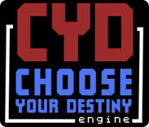

- [Choose Your Destiny tutorial](#choose-your-destiny-tutorial)
  - [Introduction](#introduction)
  - [Installation](#installation)
    - [Windows](#windows)
    - [Linux, BSDs, etc. (experimental)](#linux-bsds-etc-experimental)
    - [Highlighter for VSCode](#highlighter-for-vscode)
  - [Preparing our first adventure](#preparing-our-first-adventure)
  - [Source file format](#source-file-format)
  - [Jumps and labels](#jumps-and-labels)
  - [Options](#options)
  - [Pauses and waits](#pauses-and-waits)
  - [Text layout on screen](#text-layout-on-screen)
  - [Images](#images)
  - [Sound effects (Beeper)](#sound-effects-beeper)
  - [Versions for the different ZX Spectrum models](#versions-for-the-different-zx-spectrum-models)
  - [Music (AY)](#music-ay)
  - [Variables](#variables)
  - [Variable declaration](#variable-declaration)
  - [Subroutines](#subroutines)
  - [Conditional execution](#conditional-execution)
  - [Loops](#loops)
  - [Text compression and abbreviations](#text-compression-and-abbreviations)
  - [Organizing code with INCLUDE](#organizing-code-with-include)
  - [Using the bundled libraries](#using-the-bundled-libraries)
  - [Workflow](#workflow)
  - [Side-scrolling menus](#side-scrolling-menus)
  - [Menu keys and joystick](#menu-keys-and-joystick)
  - [Copying image fragments to screen](#copying-image-fragments-to-screen)
  - [Masked sprites](#masked-sprites)
  - [Reading the keyboard, variable arrays and indirections](#reading-the-keyboard-variable-arrays-and-indirections)
    - [Indirection](#indirection)
    - [Reading the keyboard (INKEY)](#reading-the-keyboard-inkey)
    - [Deleting characters and making line breaks (BACKSPACE and NEWLINE)](#deleting-characters-and-making-line-breaks-backspace-and-newline)
  - [Using the alternative character set](#using-the-alternative-character-set)
  - [Windows](#windows-1)
  - [Arrays or sequences](#arrays-or-sequences)
  - [Immutable data (DATA)](#immutable-data-data)
  - [Wide constants (WORD, DWORD and strings)](#wide-constants-word-dword-and-strings)
  - [More conveniences: SELECT, ENUM, SWAP and literals](#more-conveniences-select-enum-swap-and-literals)
  - [Changing the character set](#changing-the-character-set)
  - [Native routines (IMPORT / CALL)](#native-routines-import--call)

---

## Introduction

**ChooseYourDestiny** (or **CYD** for short) is an environment that will allow you to create the gamebook experience on your Spectrum. The tool consists of a compiler that, using a simple language on a ready-made text, allows you to add interactivity and visual and sound effects to "play" this type of adventure.

When designing this type of tool there are different approaches. You can design a simple tool, easy to use and understand for anyone, but at the cost of reducing its flexibility. Or you can take a compiler for a general-purpose language for the Spectrum such as **ZxBasic** by Boriel or **Z88DK**, where you need advanced knowledge of the machine and may even have to get into assembly. For **CYD** I decided to take a middle ground approach: a simple, markup-based programming language, yet flexible enough to be able to create almost anything you want, but simplified enough to focus on the creative aspects rather than the technical ones.

Therefore, this tutorial has been created to introduce concepts that will allow you to understand how it works and start making your own adventures. This document is constantly being revised and updated but may be a bit out of date with respect to the reference distribution, so the absolute reference for information will always be the manual, which is always updated with the tool. I recommend that you always have it at hand.

In addition, there are also examples in the distribution's `examples` folder, which you can play with and learn from, and which will surely give you many ideas for your own creations. Each example is a project of its own (we will see what that means shortly), so you can build it right where it is, without copying anything: for example, with `make_adv.cmd examples\test` on Windows, `./make_adv.sh examples/test` on other systems, or by opening its folder with the GUI's **Open…** button. The compiled files are left in the `OUTPUT` folder of the example.

I hope it helps you create adventures that we can all enjoy.

---

## Installation

### Windows

To install on Windows 10 (64-bit) or higher, download the `ChooseYourDestiny.Win_x64.zip` file from the [Releases](https://github.com/cronomantic/ChooseYourDestiny/releases) section of the repository and unzip it into a folder called `CYD`, which you can create wherever you see fit. The script to build the adventure is called `make_adv.cmd`; you will need to run it to compile the adventure. I recommend doing this from the command line. Your adventures won't go in this folder, but each one in a folder of its own, as we will see in the next chapter.

### Linux, BSDs, etc. (experimental)

You must first meet the prerequisites; for this, see the relevant section of the [manual](MANUAL_en.md).

Then download the `ChooseYourDestiny.Linux_x64.zip` file from the [Releases](https://github.com/cronomantic/ChooseYourDestiny/releases) section of the repository and unzip it into a folder called `CYD`, which you can create wherever you see fit. The script to build the adventures is called `make_adv.sh`; you will need to run it to compile the adventure. I recommend doing this from the command line. Your adventures won't go in this folder, but each one in a folder of its own, as we will see in the next chapter.

### Highlighter for VSCode

To start using the extension with Visual Studio Code, [download](https://github.com/cronomantic/chooseyourdestiny-highlighter/releases) the file chooseyourdestiny-highlighter-x.x.x.vsix from Releases. In VSCode, go to the Extensions screen and click the ... button to open a menu. From it, select the Install from VSIX option and open the previous file.

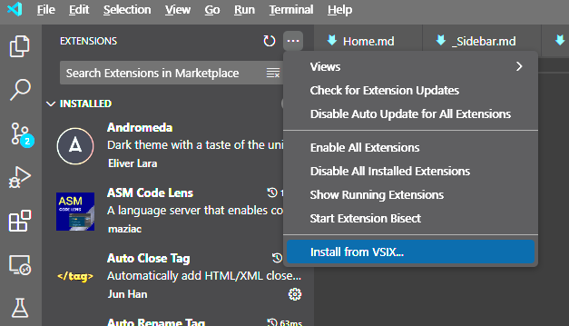

Otherwise, download this repository and copy the folder into the `<user home>/.vscode/extensions` folder and restart VSCode. If your VSCode installation is portable, it must be copied to the folder `data/extensions/` inside the VSCode folder.

---


## Preparing our first adventure

In **CYD**, each adventure lives in a folder of its own, which we call the **project**. In it go the main source file (with the extension `.cyd`), the images, the music, the sound effects and the rest of the game's files, and, optionally, a file called `cyd_project.ini` with its settings. The compiled files are left in the project's `OUTPUT` folder. CYD's own folder (the one with `make_adv.cmd`) can't be a project: this way your adventures are kept apart from the tool, and you won't have to move them when you upgrade CYD.

So the first thing we are going to do is create a project for our tutorial. The easiest way is to let CYD do it for us. If you are using Windows, open a command line window in CYD's folder and type:

```batch
dist\python\python make_adventure.py --new ..\tutorial 48k
```

If you use another operating system, the process is similar:

```bash
python3 make_adventure.py --new ../tutorial 48k
```

This creates a folder called `tutorial` next to CYD's folder, with a short adventure to start from called `tutorial.cyd`, the folders `IMAGES` and `TRACKS`, and its `cyd_project.ini`. The `48k` at the end is the Spectrum model we are going to make the adventure for; we will talk about it later. You can also do this with the **New…** button of the GUI (see [GUI compiler alternative](#gui-compiler-alternative)), choosing `48k` as its target, or simply by creating the `tutorial` folder yourself, since `cyd_project.ini` is optional; mind you, without it the default model is `128k`, so you will have to give `48k` when building (we will see how in the chapter [Versions for the different ZX Spectrum models](#versions-for-the-different-zx-spectrum-models)).

If you open `cyd_project.ini` with any text editor, you will see this:

```ini
; Choose Your Destiny project. Paths are relative to this folder.
[project]
name = tutorial
main = tutorial.cyd
target = 48k

[paths]
images = IMAGES
tracks = TRACKS
output = OUTPUT

[options]
```

`name` is the name of the adventure, which is also the name of the TAP file or the +3 disk image; `main` is the source file to compile, and `target` is the Spectrum model. The lines starting with `;` are comments. All the settings are optional: when one is missing, its default value is used (the manual lists all of them in its *Projects* section). Two of them will be useful later on: `load_scr`, in `[paths]`, is the loading screen (`IMAGES/LOAD.scr` by default), and `image_lines`, in `[options]`, is the number of lines of the images (192 by default).

Now open `tutorial.cyd` with your text editor and replace its contents with this:

```
Hello World[[WAITKEY]]
```

We save the file and build the adventure. On Windows, from CYD's folder:

```batch
make_adv.cmd ..\tutorial
```

Or, even easier, drag the `tutorial` folder onto `make_adv.cmd` in the file explorer. On other operating systems:

```bash
./make_adv.sh ../tutorial
```

If everything goes well, you will have created a tape file called `tutorial.tap` in the `OUTPUT` folder of the project, which you can run with your favorite emulator. If you don't want to type the project's folder every time, put it in the `PROJECT` variable at the beginning of `make_adv.cmd` (`SET PROJECT=..\tutorial`) or `make_adv.sh` (`PROJECT="../tutorial"`), and the script will build it when you run it without arguments. You can also open the folder with the GUI's **Open…** button and press **Compile**.

## Source file format

When launching the resulting TAP file with an emulator, this comes out:

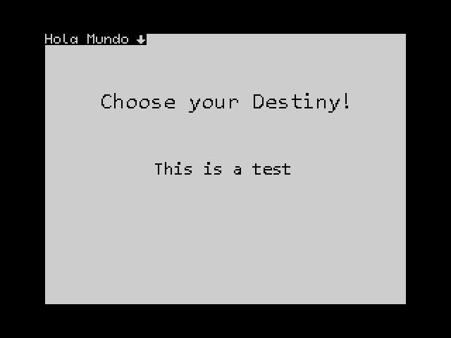

Let's analyze what happens...

Apart from `name`, another important setting of `cyd_project.ini` is `target`, which indicates the Spectrum model and the type of output file to use. For now we will use the value `48k`, which we will later change when we want more advanced features.

Returning to the code of the adventure, we see that the text *Hello World* is printed and then a kind of cursor appears. If we press the `Enter` or `Space` key, the program is restarted. If we return to the code:

```
Hello World[[WAITKEY]]
```

There are two different parts, one is the *Hello World*, and then *[[WAITKEY]]*. The second part is a command that is sent to the interpreter to bring up that animated cursor and wait for a key to be pressed. This is the fundamental basis for understanding how the compiler works: **Everything between `[[` and `]]` is considered code or commands for the engine and everything outside is considered printable text**.

To understand this better, let's do an experiment. Let's put a line break after the two open brackets, like this:

```
Hello World[[
WAITKEY]]
```

If we compile and load the game, we see that the same thing happens. Now, we delete the line break we put and put it **before** the double brackets:

```
Hello World
[[WAITKEY]]
```

If we compile and load again, we see that now the icon is on the next line:

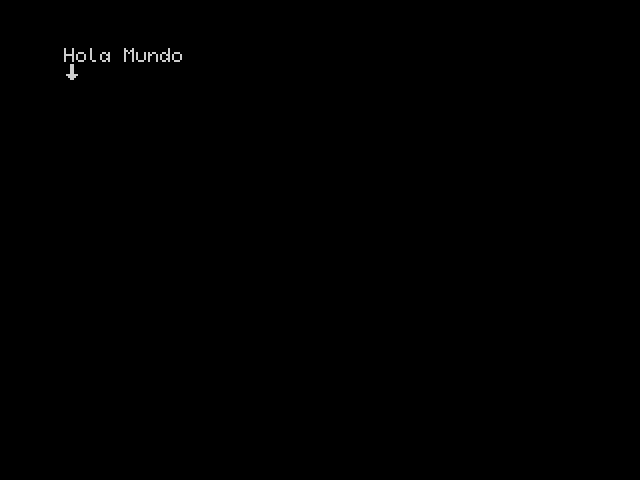

That is because the line break, being outside the double brackets, is considered printable text and, therefore, the waiting icon passes to the next line. Keep these situations in mind when you write the adventure.

Let's leave this as it was and we will add more commands. Type this within `tutorial.cyd`:

```
[[CLEAR]]Hello World[[WAITKEY]]
```

Now we have put a command ahead of the text. If we compile and execute, we get this:

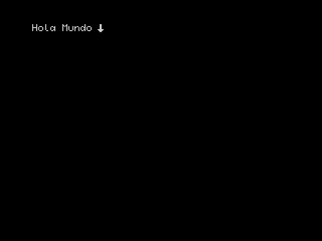

With the CLEAR command we clear the printable area that, for the moment, is the full screen. As the screen is automatically cleared when the interpreter starts, we will not see anything at the moment, but with this command we will have the clean screen to print from the beginning. You have a complete reference of the commands in the [manual](MANUAL_en.md).

Now we are going to change the color of the text. For this we are going to use the INK n command, where n is a number from 0 to 7 that corresponds to the colors of the Spectrum. By default it is white, so we are going to make it cyan, which is number 5, which would be ink 5. We will put it before CLEAR, like this:

```
[[INK 5]][[CLEAR]]Hello World[[WAITKEY]]
```

The result is ...

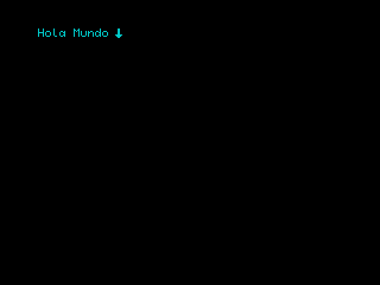

But the color is a bit dark ... let's brighten it!
To do this we use the `BRIGHT 1` command (again, look at the reference in the [manual](MANUAL_en.md)), this way:

```
[[INK 5]][[BRIGHT 1]][[CLEAR]]Hello World[[WAITKEY]]
```


This is already better.

But so many brackets can be quite confusing and unpleasant to view. As I have already indicated, every time it is `[[`, the compiler interprets that the following are commands. How can we chain them without constantly opening and closing brackets? Well... there are two ways:

- Through line breaks:
```
[[
    INK 5
    BRIGHT 1
    CLEAR
]]Hello World[[WAITKEY]]
```

- With colons on the same line:

```
[[ INK 5 : BRIGHT 1 : CLEAR ]]Hello World[[ WAITKEY ]]
```

The two previous variants will produce the same result and are equivalent.

One last point is the comments. Within the code we can put comments by surrounding them with `/*` and `*/`:

```
[[
    INK 5     /* Print in cyan color */
    BRIGHT 1  /* Enable brightness */
    CLEAR     /* Clear the screen */
]]Hello World[[
  WAITKEY     /* Wait for a key press */
]]
```

With this you should have a good notion of how the CYD source code works.

---

## Jumps and labels

In the example from the previous chapter, you may have noticed that when we press the confirmation key, the Spectrum is reset. This is because when we press the confirmation key (while waiting with WAITKEY), it reaches the end of the file. When this happens, the Spectrum is reset. We can do the same thing by using the END command anywhere in the code.

But we don't want it to do that. We want it to start over again. To do this, copy the following into the source file:

```
[[
  LABEL principio
  INK 5
  BRIGHT 1
  CLEAR
]]Hello World[[
  WAITKEY
  GOTO principio
]]
```

When you compile and run it, it won't look very nice, but you'll notice that when you press the confirmation key, it doesn't reset, but rather clears the screen and prints the text and waits again.

The two additions to the code are `LABEL principio` and `GOTO principio`. The first command is not really a command, but a label, which puts a marker at that point with an identifier named *principio*; and the second tells the interpreter to jump to where the label *principio* is located.

The result is that, when you press the confirmation key with WAITKEY, the `GOTO principio` is found and jumps to where the label *principio* is declared, which, being the beginning, re-executes all the subsequent commands, prints the text *Hello World* and waits with WAITKEY again... In short, we have made an infinite loop.

However, we can improve the example like this:

```
[[
  INK 5
  BRIGHT 1
  LABEL principio
  CLEAR
]]Hello World[[
  WAITKEY
  GOTO principio
]]
```

Now the label is declared just before the screen is cleared, and it will go there when the GOTO is reached, leaving the INK and BRIGHT unexecuted. Why? Because it is no longer necessary to execute them again: we have already set the text color and brightness at the beginning and executing them again is redundant!

The concept of labels and jumps is fundamental to understanding how to make a "Choose Your Own Adventure", since we will present options to the player, and depending on those options, we will go from one place to another in the text.

An important detail is the format of the label identifiers. These can only be a **sequence of letters, digits or underscores with no spaces, and must start with a letter or an underscore. Accented letters and the ñ are not allowed**. That is, `LABEL 1` or `LABEL La Etiqueta` are not valid, but `LABEL l1` or `LABEL LaEtiqueta` are. They are also **case sensitive**, so `LABEL Etiqueta` and `LABEL etiqueta` are not the same label. And obviously, you cannot declare a label with the same name twice.

On the other hand, commands are not case sensitive, meaning that `CLEAR`, `clear` or `Clear` are perfectly valid. However, I recommend capitalizing them to better distinguish them.

Starting with version 0.5, a shorthand way of declaring labels has been added, prefixing the label name with the character `#`, meaning that `LABEL Etiqueta` can be written as `#Etiqueta`. Thus, the previous example can be written like this:

```
[[
  INK 5
  BRIGHT 1
  #principio
  CLEAR
]]Hello World[[
  WAITKEY
  GOTO principio
]]
```

---

## Options

Options are the most important feature of the engine. Again, let's see it with the example from the manual:

```
[[ /* Set screen colors and clear it */
   PAPER 0    /* Black background color  */
   INK   7    /* White text color */
   BORDER 0   /* Black border color  */
   CLEAR      /* Clear the screen*/
]][[ LABEL Localidad1]]You are in location 1. Where do you want to go?
[[ OPTION GOTO Localidad2 ]]Go to location 2
[[ OPTION GOTO Localidad3 ]]Go to location 3
[[ CHOOSE ]]
[[ LABEL Localidad2 ]]You did it!!!
[[ GOTO Final ]]
[[ LABEL Localidad3 ]]You are dead!!!
[[ GOTO Final]]
[[ LABEL Final : WAITKEY: END ]]
```

When compiling and running we have this:

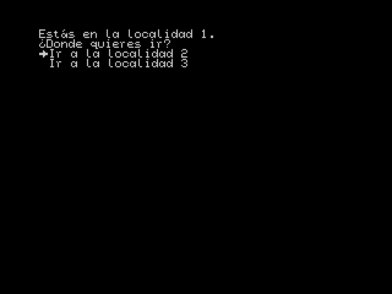

We are shown two options that we can choose with the **Q** and **A** keys and select one with **Space** or **Enter**.
If we choose the first option, we get this:

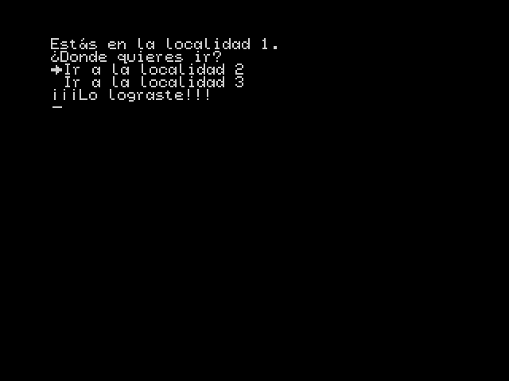

And if we choose the second:

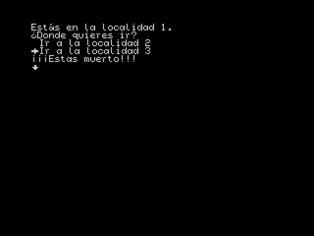

With the command `OPTION GOTO label`, what we do is declare a selectable option. The place where the cursor is at that moment will be the point where the option icon appears. Let's rearrange the options a bit to illustrate this last point:

```
[[ /* Set screen colors and clear it */
   PAPER 0    /* Black background color  */
   INK   7    /* White text color */
   BORDER 0   /* Black border color  */
   CLEAR      /* Clear the screen*/
]][[ LABEL Localidad1]]You are in location 1.
Where do you want to go?

  [[ OPTION GOTO Localidad2 ]]Go to location 2

  [[ OPTION GOTO Localidad3 ]]Go to location 3
[[ CHOOSE ]]
[[ LABEL Localidad2 ]]You did it!!!
[[ GOTO Final ]]
[[ LABEL Localidad3 ]]You are dead!!!
[[ GOTO Final]]
[[ LABEL Final : WAITKEY: END ]]
```

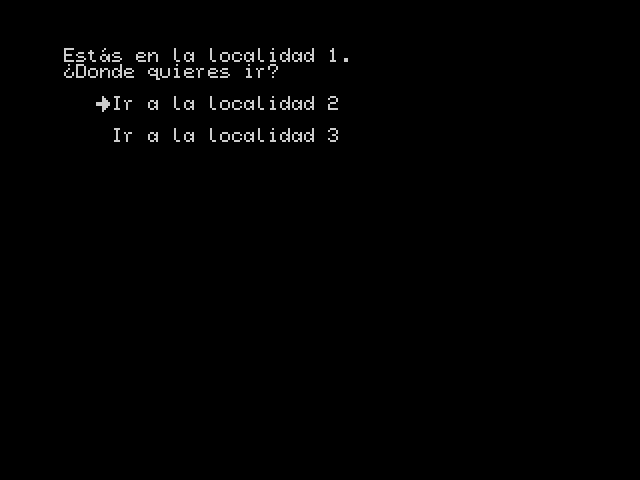

As you can see, we have separated the options with line breaks and put two spaces of indentation before the `OPTION GOTO` command and this is reflected in the final result.

Once the options have been declared, with the `CHOOSE` command, we activate the menu, which will allow us to choose between one of the options that were already on the screen. When we select one, it will jump to the label indicated in the corresponding `OPTION GOTO`. In the example, if we select the first option, `OPTION GOTO Localidad2`, it will jump to the label `LABEL Localidad2` and print *You did it* and then jump to the label `LABEL Final`. The `GOTO Final` is necessary, because otherwise it would print *You did it!!!* and then *You are dead!!!*; the `GOTO` is necessary, in this case, to avoid the result of the second option being executed.

As an additional note with `CHOOSE`, only a maximum of 32 options and a minimum of one are allowed (useless, but allowed). Outside that range the interpreter will give an error.

Also note that there is a timed variant of `CHOOSE`; compile and run this without selecting anything from the menu:

```
[[ /* Set screen colors and clear it */
   PAPER 0    /* Black background color  */
   INK   7    /* White text color */
   BORDER 0   /* Black border color  */
   CLEAR      /* Clear the screen*/
]][[ LABEL Localidad1]]You are in location 1.
Where do you want to go?

  [[ OPTION GOTO Localidad2 ]]Go to location 2

  [[ OPTION GOTO Localidad3 ]]Go to location 3
[[ CHOOSE IF WAIT 500 THEN GOTO Localidad3]]
[[ LABEL Localidad2 ]]You did it!!!
[[ GOTO Final ]]
[[ LABEL Localidad3 ]]You are dead!!!
[[ GOTO Final]]
[[ LABEL Final : WAITKEY: END ]]
```

You will notice that after about 10 seconds, it displays *You are dead!!!*.

What `CHOOSE IF WAIT 500 THEN GOTO Localidad3` does is the same as `CHOOSE`, activate the selection of options, but with the exception that it also performs a countdown, in this case from 500. If this countdown reaches zero without anything being selected, then the jump is made to the indicated label; in this case *Localidad3*.
The counter works based on the Spectrum frames, that is, 1/50 of a second, so 500/50 = 10 seconds. We will see this in the next chapter.

Again, we could rewrite the previous code like this with the shortened form of the labels:

```
[[ /* Set screen colors and clear it */
   PAPER 0    /* Black background color  */
   INK   7    /* White text color */
   BORDER 0   /* Black border color  */
   CLEAR      /* Clear the screen*/
]][[ #Localidad1 ]]You are in location 1.
Where do you want to go?

  [[ OPTION GOTO Localidad2 ]]Go to location 2

  [[ OPTION GOTO Localidad3 ]]Go to location 3
[[ CHOOSE IF WAIT 500 THEN GOTO Localidad3]]
[[ #Localidad2 ]]You did it!!!
[[ GOTO Final ]]
[[ #Localidad3 ]]You are dead!!!
[[ GOTO Final]]
[[ #Final : WAITKEY: END ]]
```

From now on, I'll be using the shortened form for labels.

With this we already have the basis for making a basic "Choose Your Own Adventure". But we still have many more possibilities to explore...

---

## Pauses and waits

In the previous examples you will have already seen the `WAITKEY` command. This command generates a pause, with an animated icon, waiting for the confirmation key to be pressed. With this you can control the display of the text and avoid the user having to read a wall of text in one sitting, as well as allowing you to control the presentation.

An example would be when the "page" is ending and we want the user to press a key to move to the next one, which we can do like this:

```
Text at the end of the page.[[
  WAITKEY
  CLEAR
]]Text at the beginning of the next page.
```

With the `WAITKEY` we wait, and when we confirm, with the following `CLEAR` we erase the text on the screen and start writing from the beginning of what would be the next "page".

However, there is an option for CYD to do this on its own. The default behavior when we finish printing on the last line is to completely clear the screen and continue writing; but with the `PAGEPAUSE` command we can activate an alternative behavior. If we indicate `PAGEPAUSE 1`, for example, when the available space runs out, it will automatically generate a wait for the user to press the confirmation key before clearing the screen and continuing printing.

In addition, there are also "timed" waits, `CHOOSE IF WAIT X THEN GOTO Y` from the previous chapter being one example. When they are executed, a counter is loaded with the value passed as a parameter and a countdown is performed until the counter reaches zero. The counter is decremented once every Spectrum frame, that is, once every 1/50 of a second, or in other words, 50 times per second. So, if we want to wait a second, we have to set the counter to 50.

With this, we know enough to look at the commands:

- With the `WAIT` command, an unconditional wait is performed; it is a stop until the counter runs out.

```
Wait three seconds[[WAIT 150]]
Done[[WAITKEY]]
```

- The `PAUSE` command is a combination of `WAITKEY` and `WAIT`: a wait is performed until the counter runs out or the user presses the confirmation key; we could consider it a `WAITKEY` with a timeout.

```
Wait three seconds or press a key[[PAUSE 150]]
Done[[WAITKEY]]
```

- `CHOOSE IF WAIT X THEN GOTO Y` has already been explained in the previous chapter. If the counter runs out before a menu option is selected, the indicated jump is made.

Finally, let's talk about the `TYPERATE` command, which is a bit special compared to the rest of the wait commands. With this command we indicate the wait that occurs each time a character is printed. This wait is not adjusted to frames, but is a counter that depends on the speed of the processor (faster). The idea of this command is to write in a slower and more gradual way, for certain "dramatic" situations.

```
[[TYPERATE 10000]]This prints slowly
[[TYPERATE 0]]This prints normally[[WAITKEY]]
```

---
## Text layout on screen

One of the most important parts of designing a CYD adventure is adjusting the presentation of the text. CYD doesn't "know" how to present the text. As authors, we have to help it.

We can visualize its behavior by imagining that there is an invisible cursor on the screen that prints the text from left to right and from top to bottom. The engine always tries to ensure that the words do not break, so that if the next word does not fit on the remaining line, it jumps to the next line and prints it there. Any text separated by spaces is considered a word.

Let's put a text like *Lorem ipsum*, all in one go, without line breaks:

```
[[ /* Set screen colors and clear it */
   PAPER 0    /* Black background color  */
   INK   7    /* White text color */
   BORDER 0   /* Black border color  */
   CLEAR      /* Clear the screen*/
   PAGEPAUSE 1
]]Lorem ipsum dolor sit amet, consectetur adipiscing elit. Nam eget pretium felis. Quisque tincidunt tortor eget libero fermentum, rutrum aliquet nisl semper. Pellentesque id eros non leo ullamcorper hendrerit. Fusce pretium bibendum lectus, vel dignissim velit interdum quis. Integer vel ipsum ac elit tincidunt vulputate. Mauris sagittis sapien in justo pretium cursus. Proin nec tincidunt purus, et tempus metus. Nunc dapibus vel ante eu dictum. Donec vestibulum scelerisque orci in tempus. Nunc quis velit id velit faucibus tempus vel id tellus.[[ WAITKEY: END ]]
```

This is the result:

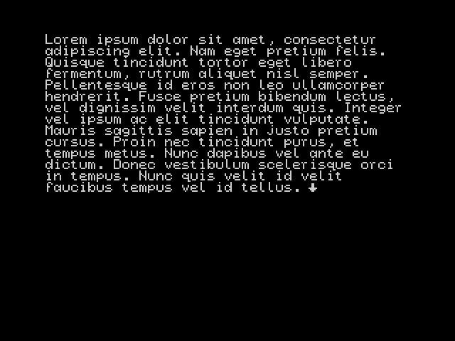

You can see that words that do not fit on their line continue on the next line without being cut off.

When the print cursor reaches the last line and must move to the next line, the screen is cleared and printing continues from the origin of the screen, at the top left; except if you use the `PAGEPAUSE` command, which generates a confirmation wait before clearing the screen.

We can lay out the screen properly using spaces and line breaks as needed, but if we want to make an indent or tabs, you have the `TAB pos` command, which prints as many spaces as indicated in the parameter:

```
[[ /* Set screen colors and clear it */
   PAPER 0    /* Black background color  */
   INK   7    /* White text color */
   BORDER 0   /* Black border color  */
   CLEAR      /* Clear the screen*/
   PAGEPAUSE 1
]]Normal text
[[TAB 5]]Text 5 positions to the right.[[ WAITKEY: END ]]
```

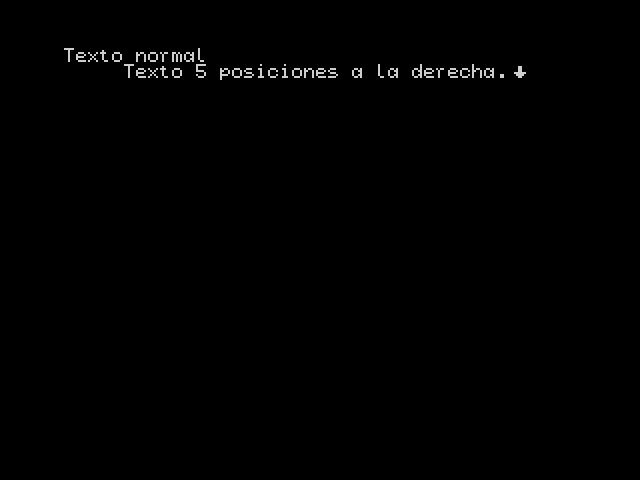

The `TAB` command allows us to save memory because, if we want to print 10 spaces, those 10 spaces will consume more than using the `TAB 10` command.

Similarly, we have the `REPCHAR` command to print any character repeatedly:

```
[[ /* Set screen colors and clear it */
   PAPER 0    /* Black background color  */
   INK   7    /* White text color */
   BORDER 0   /* Black border color  */
   CLEAR      /* Clear the screen*/
   PAGEPAUSE 1
]]Normal text
[[ TAB 5 ]]Text 5 positions to the right.
[[ REPCHAR 35, 10 ]]
[[ WAITKEY: END ]]
```

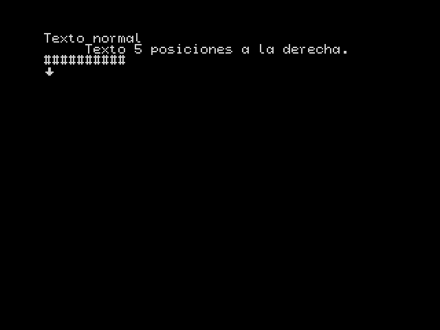

This repeats character 35 (the hash sign) 10 times. And if we want to print it only once, we have the `CHAR` command:

```
[[ /* Set screen colors and clear it */
   PAPER 0    /* Black background color  */
   INK   7    /* White text color */
   BORDER 0   /* Black border color  */
   CLEAR      /* Clear the screen*/
   PAGEPAUSE 1
]]Normal text
[[ TAB 5 ]]Text 5 positions to the right.
[[ REPCHAR 35, 10 ]]
[[ CHAR 35 ]]
[[ WAITKEY: END ]]
```

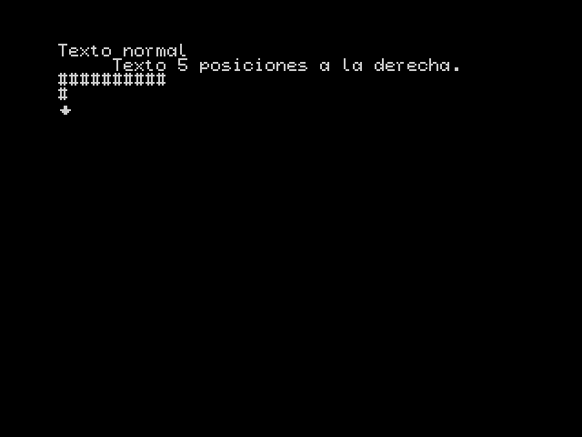

And to make a line break, the `NEWLINE` command:

```
[[ /* Set screen colors and clear it */
   PAPER 0    /* Black background color  */
   INK   7    /* White text color */
   BORDER 0   /* Black border color  */
   CLEAR      /* Clear the screen*/
   PAGEPAUSE 1
]]Normal text
[[ TAB 5 ]]Text 5 positions to the right.
[[ NEWLINE : REPCHAR 35, 10 ]]
[[ CHAR 35 ]]
[[ WAITKEY: END ]]
```

Let's now look at a command to place the print cursor anywhere on the screen. With the command `AT column,row`, we can indicate the coordinates where we want to place the cursor to continue printing. Let's see it with this example:

```
[[ /* Set screen colors and clear it */
   PAPER 0    /* Black background color  */
   INK   7    /* White text color */
   BORDER 0   /* Black border color  */
   CLEAR      /* Clear the screen*/
   PAGEPAUSE 1
]]
Text below
[[AT 5,0]]Is this at the top?.[[ WAITKEY: END ]]
```

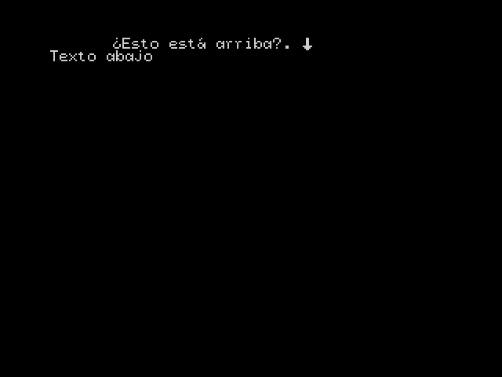

What happened here? If we examine the code, we see that before "Text below", there is a line break. So the cursor jumps to the next line and prints the "Text below", but after that we have `AT 5,0`, which means *move the cursor to column 5 and row 0*, that is, it goes back to the previous row and 5 positions to the right from the origin.

With this we can now place text wherever we want. But we are missing something to fully control the layout of the text on the screen, and that is to define some margins. By default CYD prints the text in full screen, but we may want it to only print in a certain area so as not to "cover" images that we want to show. For this we have the command `MARGINS`, which allows us to indicate the "rectangle" or print area of the texts.

The format of the command is `MARGINS origin_col, origin_row, width, height`, where the parameters are the origin column and row of the print area and the corresponding width and height. By default, the engine starts as if the command `MARGINS 0, 0, 32, 24` had been executed, that is, the origin at the top left corner of the screen and the size set to the full screen.

Now let's go back to the initial example of this chapter and put it in the lower area of the screen:

```
[[ /* Set screen colors and clear it */
   PAPER 0    /* Black background color  */
   INK   7    /* White text color */
   BORDER 0   /* Black border color  */
   CLEAR      /* Clear the screen*/
   PAGEPAUSE 1
   MARGINS 0, 10, 32, 14
]]Lorem ipsum dolor sit amet, consectetur adipiscing elit. Nam eget pretium felis. Quisque tincidunt tortor eget libero fermentum, rutrum aliquet nisl semper. Pellentesque id eros non leo ullamcorper hendrerit. Fusce pretium bibendum lectus, vel dignissim velit interdum quis. Integer vel ipsum ac elit tincidunt vulputate. Mauris sagittis sapien in justo pretium cursus. Proin nec tincidunt purus, et tempus metus. Nunc dapibus vel ante eu dictum. Donec vestibulum scelerisque orci in tempus. Nunc quis velit id velit faucibus tempus vel id tellus.[[ WAITKEY: END ]]
```

We have lowered the origin of the print area to row 10, and reduced its height to 14:

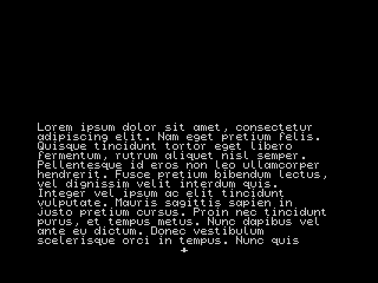

With this we can adjust the area where we want to print. Note the effect of `PAGEPAUSE 1`, which, since not everything fits, generates a confirmation icon in the center.

Now we are going to use the same thing in the second example of this chapter:

```
[[ /* Set screen colors and clear it */
   PAPER 0    /* Black background color  */
   INK   7    /* White text color */
   BORDER 0   /* Black border color  */
   CLEAR      /* Clear the screen*/
   PAGEPAUSE 1
   MARGINS 0, 10, 32, 14
]]
Text below
[[AT 5,0]]Is this at the top?.[[ WAITKEY: END ]]
```

Do you notice anything strange?

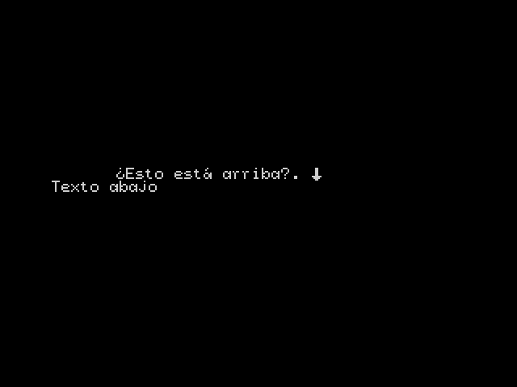

If you haven't noticed, the coordinates of `AT` are not, in this case, the screen coordinates. The coordinates of `AT` are **always relative to the origin of the print area**. When we had the area defined as the full screen, it corresponded to the screen coordinates, (0,0). Now they are relative to the new origin, (0,10), which would send the cursor to position (5,10) on the screen.

The Spectrum screen has, naturally, 32 characters per line, which is somewhat insufficient for long texts. CYD supports variable width fonts and the default one uses 6x8 characters, which allows us to have 42 characters per line, but this causes it to not match the Spectrum attribute grid, which is 8x8, and there is "color clash".

For this reason, `AT` and `MARGINS` have a character-based coordinate system of 8x8 pixels, that is, 32 columns and 24 rows, counted from 0 to 31 and 0 to 23 respectively.

Finally, let's look at an attribute collision problem with this example:

```
[[ /* Set screen colors and clear it */
   PAPER 0    /* Black background color  */
   BORDER 0   /* Black border color  */
   CLEAR      /* Clear the screen*/
   PAGEPAUSE 1
   INK   7    /* Blue text color */
]]LALALALALA[[INK 4 /* Green color */]] LOLOLOLOLOLO[[ WAITKEY: END ]]
```

You can see that when you change the color to green with the `INK` command, because the next character to be printed (a space) is between two attribute cells, the previous character is painted white:


We can solve this by changing the color after the space:

```
[[ /* Set screen colors and clear it */
   PAPER 0    /* Black background color  */
   BORDER 0   /* Black border color  */
   CLEAR      /* Clear the screen*/
   PAGEPAUSE 1
   INK   7    /* White text color */
]]LALALALALA [[INK 4 /*Green color */]]LOLOLOLOLOLO[[ WAITKEY: END ]]
```

And now it's correct:

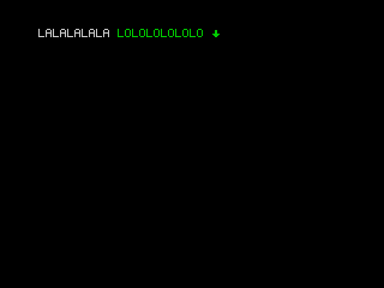

The author will need to make these small adjustments to improve the presentation of the text. If you want to avoid them completely, do not mix different colors within the same line.

---

## Images

To make the adventure more attractive, it is possible to add images in SCR format, of Spectrum screens. These images will be compressed, creating `CSC` files that will be included in the final program.

The compiler automatically searches for and compresses the SCR files that are in the `IMAGES` folder of the project, so you will simply have to place the files there.

We are going to use an image that we have as an example, called `ORIGIN1.SCR`, inside the `examples\test\IMAGES` folder of CYD. Copy it to the `IMAGES` folder of your project and rename it to `001.SCR`. And put the following code in `tutorial.cyd`:

```
[[ /* Set screen colors and clear it */
   PAPER 0    /* Black background color  */
   BORDER 0   /* Black border color  */
   CLEAR      /* Clear the screen*/
   INK   7    /* White text color */
   PAGEPAUSE 1
]]I'm going to load screen 1.[[
   WAITKEY
   /* Load the image from file 001.CSC */
   PICTURE 1]]
I'm going to display the image.[[
   WAITKEY
   /* Display the loaded image  */
   DISPLAY 1
]]
Done[[ WAITKEY: END ]]
```

The compiler looks in the `IMAGES` folder for files named xxx.SCR, where the three x's are digits, and compresses them (it keeps the compressed images in the `cyd_cache` folder of the output folder, `OUTPUT`, so it only compresses an image again when it changes). On the disk they go as files with the extension `.CSC`, like `001.CSC`. The engine will search the disk for files with this name when asked to load images in the case of the disk version. In the tape versions, they will be stored and decompressed in memory.

Now we can launch the emulator. The first thing you will see is this:

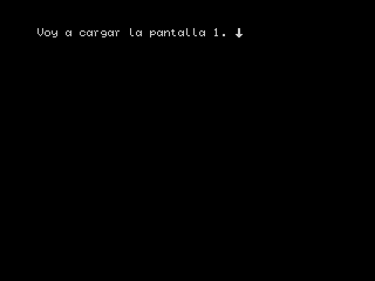

When you press the confirmation key, the `PICTURE 1` command will be launched. What this command will do is load and decompress the image file `001.CSC` into memory, but be careful, it is not displayed yet! You will notice that the disk has been accessed (this depends on the emulator).

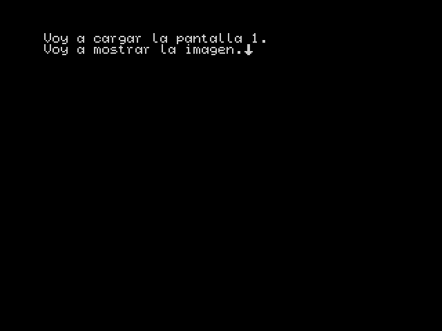

With this we have the image loaded, but to display it, we have to use the `DISPLAY 1` command, and then the image is displayed:

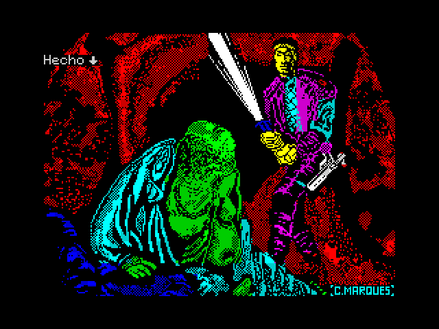

We can now display images, but there are a few things to clear up first. The first thing you might be wondering is... what is the 1 in DISPLAY for? As stated in the reference, the `DISPLAY` command needs a parameter indicating whether to display the image or not; if the value is zero, it does not display it, and if it is non-zero, it does. This may seem pointless, but it makes sense if used with variables, to cause the image to be displayed conditionally based on the value of a variable.

Another thing you might be wondering is why the commands to load the image and display it are separate, instead of using a single command to do both. Well, the answer is a design decision for the disk version, since by separating the loading into a separate operation, we can control when it is done to, for example, load it when a chapter starts, and then display the image at the most opportune moment, since loading will stop the engine and pause the reading at an undesirable moment. Also, both on tape and on disk, the image has to be decompressed into a "buffer", which takes a bit of time that can cause a noticeable pause.

For now, just remember that you first need `PICTURE 3`, to load the image `003.CSC`, for example, and then `DISPLAY 1` to display it. Note that we can only load one image at a time, so if we load another image, the one already loaded will be deleted, and a loaded image can be displayed as many times as we want. And you'll get a nice error if you try to load an image that doesn't exist on disk or in memory, or when displaying an image without loading it first.

When displaying images, keep in mind that whatever is already on the screen will always be overwritten. The default behavior is to load images full screen (192 lines), but you can edit the number of lines to load with the `image_lines` setting, in the `[options]` section of the project's `cyd_project.ini`:

```ini
[options]
image_lines = 192
```

Due to the color limitations of the Spectrum, I recommend that it always be a multiple of 8.

When using images, we can adjust the size of the print area so that it does not overwrite the entire drawing using `MARGINS`. Let's combine two previous examples to see this:

```
[[ /* Set screen colors and clear it */
   PAPER 0    /* Black background color  */
   INK   7    /* White text color */
   BORDER 0   /* Black border color  */
   CLEAR      /* Clear the screen*/
   PAGEPAUSE 1
   PICTURE 1
   DISPLAY 1
   MARGINS 0, 10, 32, 14
]]Lorem ipsum dolor sit amet, consectetur adipiscing elit. Nam eget pretium felis. Quisque tincidunt tortor eget libero fermentum, rutrum aliquet nisl semper. Pellentesque id eros non leo ullamcorper hendrerit. Fusce pretium bibendum lectus, vel dignissim velit interdum quis. Integer vel ipsum ac elit tincidunt vulputate. Mauris sagittis sapien in justo pretium cursus. Proin nec tincidunt purus, et tempus metus. Nunc dapibus vel ante eu dictum. Donec vestibulum scelerisque orci in tempus. Nunc quis velit id velit faucibus tempus vel id tellus.[[ WAITKEY: END ]]
```

The first thing it will do is display the image, which will overwrite the entire screen, and then we will define a lower area where the text will be drawn:

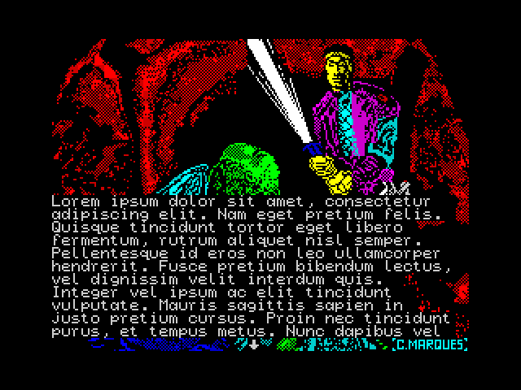

Since the text does not fit, pressing the confirmation key will clear the print area defined with `MARGINS` and continue printing the rest:

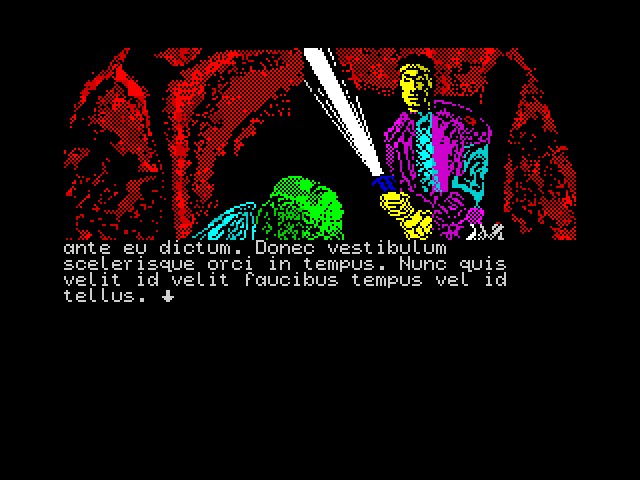

To make the behavior a little more consistent, let's put a `CLEAR` right after `MARGINS`:

```
[[ /* Set screen colors and clear it */
   PAPER 0    /* Black background color  */
   INK   7    /* White text color */
   BORDER 0   /* Black border color  */
   CLEAR      /* Clear the screen*/
   PAGEPAUSE 1
   PICTURE 1
   DISPLAY 1
   MARGINS 0, 10, 32, 14
   CLEAR
]]Lorem ipsum dolor sit amet, consectetur adipiscing elit. Nam eget pretium felis. Quisque tincidunt tortor eget libero fermentum, rutrum aliquet nisl semper. Pellentesque id eros non leo ullamcorper hendrerit. Fusce pretium bibendum lectus, vel dignissim velit interdum quis. Integer vel ipsum ac elit tincidunt vulputate. Mauris sagittis sapien in justo pretium cursus. Proin nec tincidunt purus, et tempus metus. Nunc dapibus vel ante eu dictum. Donec vestibulum scelerisque orci in tempus. Nunc quis velit id velit faucibus tempus vel id tellus.[[ WAITKEY: END ]]
```

And with this it's better:

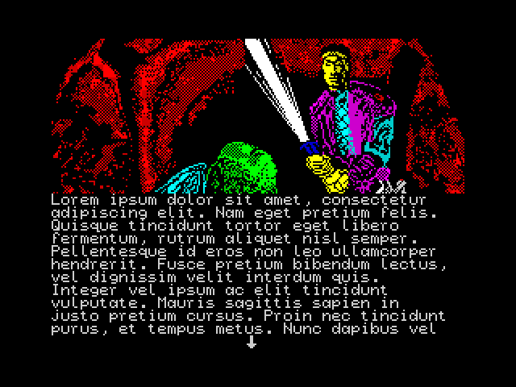

Here we've used a random image, more specifically the loading screen from *La Aventura Original*. But if we're going to do this kind of cropping with all images, we can change the value of `image_lines`, so that it crops out the lines we don't want. This will save space, and prevent the bottom text area from being overwritten when we load a new image.

For image management and taking into account these restrictions, it's important to plan in advance how and when we're going to display them.

A couple of questions may arise: what if I want to crop the size of only one image? What if I want each image to have a different number of lines? Well, it is possible to define the number of lines for each file specifically. Let's imagine that we want to leave 62 lines for the file `000.SCR`, 40 lines for the file `001.SCR`, and the rest at 192. To do this, we would have to create a file called `images.json` in the `IMAGES` folder with the following:

```json
[
  {
    "id": 0,
    "num_lines": 62,
    "force_mirror": false
  },
  {
    "id": 1,
    "num_lines": 40,
    "force_mirror": false
  }
]
```

When the compiler finds this JSON file, it will take the settings of the images indicated in it, and for the rest of the images it will use what we have set in `image_lines`. Thus, with a hypothetical image `003.SCR`, and if we have not changed `image_lines`, the 192 lines will be used, that is, the full image.

Obviously, with the `num_lines` field we indicate the number of lines of each file, but you may wonder: what is `force_mirror` for? Well, what **CYD** will do is discard the right half of the image, and when it decompresses it into the screen buffer, it will draw the left half of the image in its place, but symmetrically, that is, mirrored, which in certain situations can mean significant savings.

---

## Sound effects (Beeper)

To enhance the atmosphere of our adventure, the engine allows us to play sound effects through the Beeper. To do this we use the tool [BeepFx](http://shiru.untergrund.net/files/beepfx.zip) by Shiru, a tool widely used in new developments for the Spectrum.

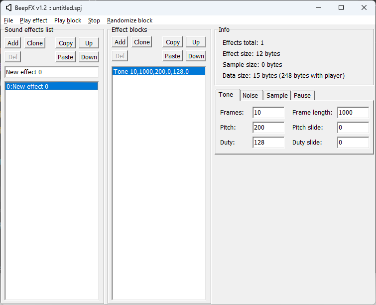

In this tutorial we are not going to teach how to use the tool, but we are going to take one of the example files included in the package. From the menu `File -> Open project`, we open the file `demo.spj`, where there are a series of effects already created. We can play them with the option `Play Effect`:

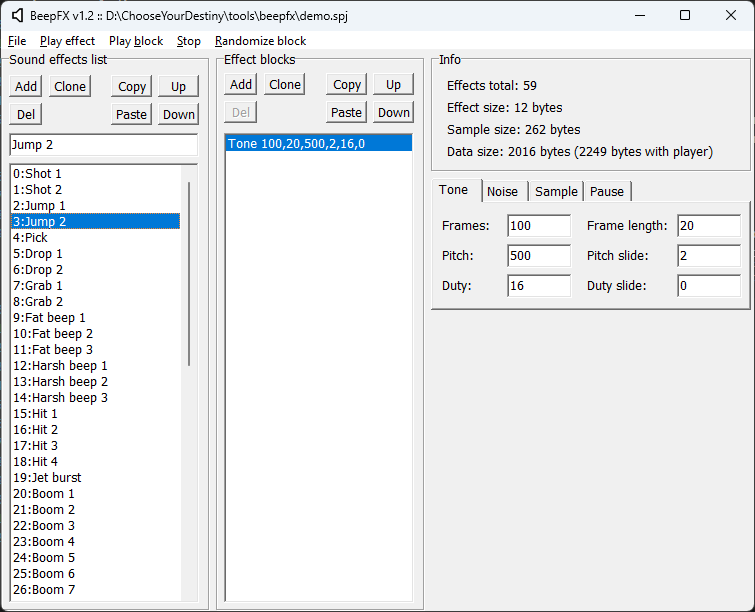

Now we are going to export it to a file that we can use with the engine. To do this, go to the menu `File -> Compile`, where this window will appear:

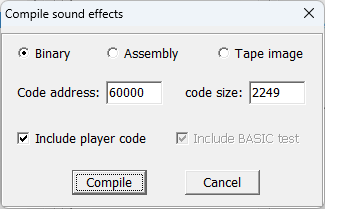

Now comes the important part, **we must always leave the `Assembly` and `Include player code` options checked**:

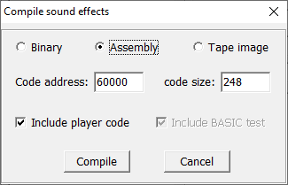

We click on the `Compile` button and a dialog box will appear to save the file. **We must call it `SFX.ASM`** and save it in the folder of our project, next to `tutorial.cyd`. When we build the adventure, if the file `SFX.ASM` is in the project's folder, it will automatically be included in the resulting file and we can use it from the engine.

Let's give an example, put this as the code for the adventure:

```
[[ /* Set screen colors and clear it */
   PAPER 0    /* Black background color  */
   BORDER 0   /* Black border color  */
   INK   7    /* White text color */
   PAGEPAUSE 1
   LABEL Menu
   CLEAR]]Select the effect to play:

  [[ OPTION GOTO Efecto0 ]]Effect 0
  [[ OPTION GOTO Efecto1 ]]Effect 1
  [[ OPTION GOTO Efecto2 ]]Effect 2
  [[ OPTION GOTO Efecto3 ]]Effect 3
  [[ OPTION GOTO Efecto4 ]]Effect 4
  [[ OPTION GOTO Final ]]Exit

[[ CHOOSE
   LABEL Efecto0 : SFX 0 : GOTO Menu
   LABEL Efecto1 : SFX 1 : GOTO Menu
   LABEL Efecto2 : SFX 2 : GOTO Menu
   LABEL Efecto3 : SFX 3 : GOTO Menu
   LABEL Efecto4 : SFX 4 : GOTO Menu
   LABEL Final]]Goodbye...[[WAITKEY: END ]]
```

As you can see, with the `SFX` command, we can play any of the effects in the file by specifying its number as a parameter.

A peculiarity of the SFX command is that, unlike images, if no effects file was included (there was no `SFX.ASM` in the project's folder when compiling), it won't give an error: the command is simply ignored and the sound effect will not be played.

---

## Versions for the different ZX Spectrum models

So far, we have only developed adventures for the original 48K ZX Spectrum, however, the 128K models can also be played on tape or disk. The disk support has the peculiarity that the pictures and melodies are not stored in memory, but are loaded dynamically from disk when the `PICTURE` and `TRACK` commands are executed.

The available space will vary depending on the adventure and the extra resources to be used, since if music and sound effects are omitted, the size of the interpreter will be reduced, leaving more space for text and images. On average, you should expect to have about 96 KB available on the 128K models and about 24 KB on the 48K models. For this reason, the 48K version does not include support for AY melodies.

To change the model, you simply have to change the `target` setting in the project's `cyd_project.ini` to the values `48k` or `128k` if you want to generate the TAPs for the corresponding models (there are also `plus3` and `esxdos`, which we will see below, and the experimental `mld` and `mld128`). For example, if we want to create a version of our tutorial for the Spectrum 128K, with the image `000.scr` of the `IMAGES` folder as its loading screen:

```ini
[project]
name = tutorial
main = tutorial.cyd
target = 128k

[paths]
images = IMAGES
tracks = TRACKS
output = OUTPUT
load_scr = IMAGES/000.scr

[options]
image_lines = 192
```

In the GUI, the **Target** you choose is saved in this same file. You can also give the model when building, without touching the file, and it will be used instead of the project's: `make_adv.cmd ..\tutorial 128k` or `./make_adv.sh ../tutorial 128k`.

With the `plus3` model, the output format will be a disk image in DSK format.

With the `esxdos` model, for divMMC/divIDE interfaces with an SD card, the result is not a single file, but several files that must be copied to the SD card; the manual explains which ones they are and where to put them.

---

## Music (AY)

CYD also allows playing music using the AY chip, using modules created with Vortex Tracker, in `PT3` format. AY music is not available for the 48K models, so we will need to change the `target` setting in `cyd_project.ini`, as described in the previous chapter.

The operation is intentionally similar to that of the images. The module file names have to be 3-digit numbers with the extension `.PT3`, so that they are `000.PT3`, `001.PT3` and so on, and they must be included on the disk. To make things easier, the compiler will do it for us with all the files that follow this naming scheme and are inside the `TRACKS` folder of the project.

The commands we have are also similar to the image management commands. With the `TRACK` command, we load a music module from disk into memory, so that with `TRACK 0`, we would load the module `000.PT3`, with `TRACK 1` we would load `001.PT3`, etc.

Once the module is loaded, we would play it with the `PLAY 1` command when we need to do so. The parameter of the `PLAY` command is a number that, if it is zero, stops the music (if it is already playing), and if it is not zero, plays it from the beginning (if it is already stopped).

Finally, with the `LOOP` command we indicate whether we want the module to play only once or we want it to play indefinitely. If the value of its parameter is zero, it will only play once, and if it is non-zero, it will start playing again when it finishes.

One detail to keep in mind is that the effect of the `LOOP` command is specific to the built-in player and is only valid when the module can finish. The `.PT3` format has repeat commands, making the module play endlessly by itself, so it is advisable to play it with an external player to see if this is the case.

---

## Variables

With what we already know, we could already make a relatively simple adventure based on options, like "Choose Your Own Adventure", but we can go further...

The engine has 256 one-byte variables or flags, that is, 256 slots where we can store values from 0 to 255. Each of these variables is identified in turn by a number from 0 to 255. Let's see it with an example:

```
[[ /* Set screen colors and clear it */
   PAPER 0    /* Black background color  */
   BORDER 0   /* Black border color  */
   INK   7    /* White text color */
   PAGEPAUSE 1
   CLEAR]][[SET 1 TO 5]]You have [[PRINT @1]] gamusinos.
[[WAITKEY : END]]
```

This is the result:

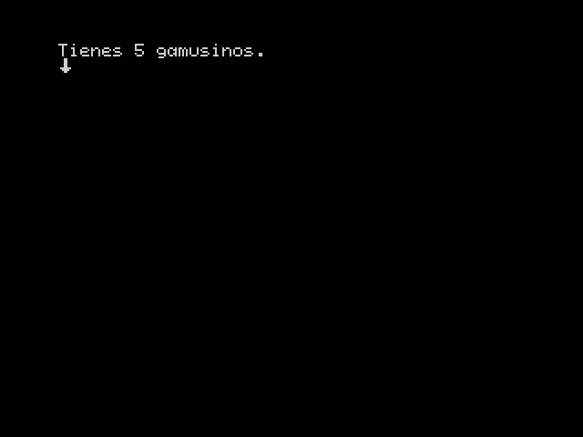

The first new thing we see is this `SET 1 TO 5`; with this we are telling the engine to save the value 5 inside the variable number 1. And as a consequence, with `PRINT @1` we are telling it to display the value of variable 1 on the screen.

One thing you might have noticed is that `PRINT` puts an at sign in front of the variable number. The at sign is the variable indicator. To explain it better, remove the at sign so that it looks like this:

```
[[ /* Set screen colors and clear it */
   PAPER 0    /* Black background color  */
   BORDER 0   /* Black border color  */
   INK   7    /* White text color */
   PAGEPAUSE 1
   CLEAR]][[SET 1 TO 5]]You have [[PRINT 1]] gamusinos.
[[WAITKEY : END]]
```


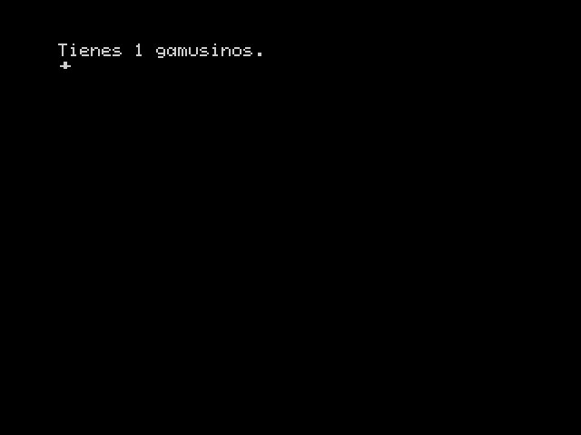

Wow! The thing is that when you put an @ sign in front, it means **take the value of the variable whose number I indicate after it**. If you have consulted the [manual](MANUAL_en.md), you will have seen that almost all commands allow expressions with variables.

Therefore, with `PRINT 1`, what you are indicating is "Print the value 1", but with `PRINT @1`, what is indicated is "Print the content of the variable 1".

Let's reinforce this concept with this example:

```
[[ /* Set screen colors and clear it */
   PAPER 0    /* Black background color  */
   BORDER 0   /* Black border color  */
   INK   7    /* White text color */
   PAGEPAUSE 1
   CLEAR
   SET 1 TO 5
   SET 0 TO @1
]]You have [[PRINT @0]] gamusinos.
[[WAITKEY : END]]
```

Again, we have 5 gamusinos:

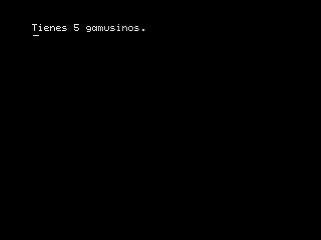

With `SET 1 TO 5` we store 5 in variable number 1. Then with `SET 0 TO @1`, what we do is store in the variable number 0 the value that variable number 1 contains and finally, with `PRINT @0`, we display the content of variable number 0.

Now we are going to see a more practical example of variables, which will test our knowledge acquired in this tutorial:

```
[[ /* Set screen colors and clear it */
   PAPER 0    /* Black background color  */
   BORDER 0   /* Black border color  */
   INK   7    /* White text color */
   PAGEPAUSE 1
   SET 0 TO 0
   #Inicio
   CLEAR
]]You have [[PRINT @0]] gamusinos.
You need 10 gamusinos to be able to leave...
What do you do?

[[OPTION GOTO Suma1]]I take 1 gamusino.
[[OPTION GOTO Resta1]]I drop 1 gamusino.
[[
   IF @0 <> 10 THEN GOTO Escoger ENDIF
   OPTION GOTO Final]]Exit.
[[
   #Escoger
   CHOOSE
   #Suma1
   SET 0 TO @0 + 1
   GOTO Inicio
   #Resta1
   SET 0 TO @0 - 1
   GOTO Inicio
   #Final]]Thanks for playing![[WAITKEY : END]]
```

It shows us this menu:

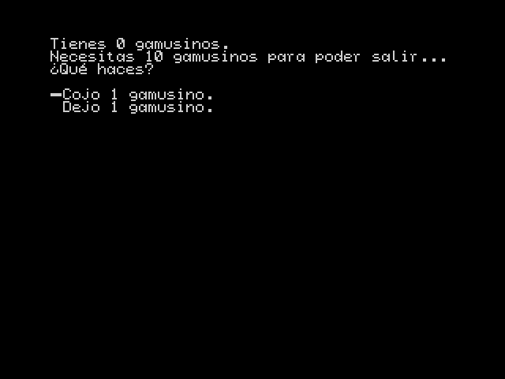

If we choose the first option, it adds 1 to the variable 0, which is done by the command `SET 0 TO @0 + 1`, and the second option subtracts, and it does so with `SET 0 TO @0 - 1`.

The first thing that may catch your attention is that if I hit subtract when the value is zero, it does nothing. This is correct: you cannot subtract below zero or add above 255 in the variables.

And the second, where is the exit option? We are going to catch gamusinos until we have 10, as indicated:

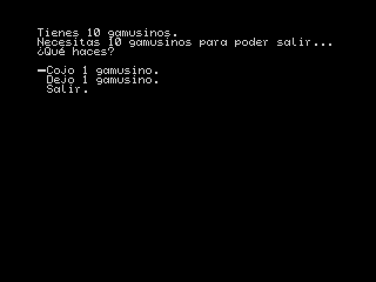

Now we can exit! The secret is in the conditionals. If we look at the exit option, we see that before it there is `IF @0 <> 10 THEN GOTO Escoger ENDIF`, which means "If the variable zero is not equal to 10, jump to the 'Escoger' label", which causes the "Exit" option to be skipped and not reflected in the menu until the value of the variable 0 is 10.

That is, with variables and conditions, we have the necessary tools to make menus of options or texts that vary depending on certain conditions and make our adventure more dynamic.

---

## Variable declaration

This program can look quite cryptic:

```
[[ /* Set screen colors and clear it */
   PAPER 0    /* Black background color  */
   BORDER 0   /* Black border color  */
   INK   7    /* White text color */
   PAGEPAUSE 1
   SET 0 TO 0
   #Inicio
   CLEAR
]]You have [[PRINT @0]] gamusinos.
You need 10 gamusinos to be able to leave...
What do you do?

[[OPTION GOTO Suma1]]I take 1 gamusino.
[[OPTION GOTO Resta1]]I drop 1 gamusino.
[[
   IF @0 <> 10 THEN GOTO Escoger ENDIF
   OPTION GOTO Final]]Exit.
[[
   #Escoger
   CHOOSE
   #Suma1
   SET 0 TO @0 + 1
   GOTO Inicio
   #Resta1
   SET 0 TO @0 - 1
   GOTO Inicio
   #Final]]Thanks for playing![[WAITKEY : END]]
```

The first thing we are going to do is declare a variable, that is, give a name or alias to one of the flags so we can refer to it by its name. Let's take a look at it:

```
[[ /* Set screen colors and clear it */
   PAPER 0    /* Black background color  */
   BORDER 0   /* Black border color  */
   INK   7    /* White text color */
   PAGEPAUSE 1
   DECLARE 0 AS NumGamusinos
   SET NumGamusinos TO 0
   #Inicio
   CLEAR
]]You have [[PRINT @NumGamusinos]] gamusinos.
You need 10 gamusinos to be able to leave...
What do you do?

[[OPTION GOTO Suma1]]I take 1 gamusino.
[[OPTION GOTO Resta1]]I drop 1 gamusino.
[[
   IF @0 <> 10 THEN GOTO Escoger ENDIF
   OPTION GOTO Final]]Exit.
[[
   #Escoger
   CHOOSE
   #Suma1
   SET NumGamusinos TO @NumGamusinos + 1
   GOTO Inicio
   #Resta1
   SET NumGamusinos TO @NumGamusinos - 1
   GOTO Inicio
   #Final]]Thanks for playing![[WAITKEY : END]]
```

This is much better: with `DECLARE 0 AS NumGamusinos` we are telling the compiler that, from now on, the variable 0 will be called NumGamusinos, and we can use that name instead. With this we can give a meaningful name to the flags. Also keep in mind the following:

- We can still refer to the variable by its number.
- We cannot declare a variable and a label with the same name.
- We cannot declare two different variables with the same name.
- We can give two different names to the same variable.

---

## Subroutines

Subroutines are a special type of jump that stores the position it was made from, which can be recovered later, allowing you to continue from the same point where you entered. This is a classic programming concept of "subroutines" or "subprograms", used for repetitive tasks, which will surely sound familiar to those who have programmed something in BASIC.

As always, let's see it with a simple example to understand it:

```
[[ /* Set screen colors and clear it */
   PAPER 0    /* Black background color  */
   BORDER 0   /* Black border color  */
   INK   7    /* White text color */
   PAGEPAUSE 1
   DECLARE 0 AS NumGamusinos
   SET NumGamusinos TO 0
   #Inicio
   CLEAR]]You have [[GOSUB ImprimirGamusinos]].
What do you do?

[[OPTION GOTO Suma1]]I take 1 gamusino.
[[OPTION GOTO Resta1]]I drop 1 gamusino.
[[OPTION GOTO Final]]Exit.
[[
   #Escoger
   CHOOSE
   #Suma1
   SET NumGamusinos TO @NumGamusinos + 1
   GOTO Inicio
   #Resta1
   SET NumGamusinos TO @NumGamusinos - 1
   GOTO Inicio
   #Final]]Thanks for playing!
In the end you keep [[GOSUB ImprimirGamusinos]].[[
   WAITKEY
   END
   /* Gamusino printing subroutine*/
   #ImprimirGamusinos : PRINT @NumGamusinos]] gamusinos[[RETURN]]
```

The gamusinos example again... But this time we print the number of gamusinos twice, when we choose an option and at the very end.

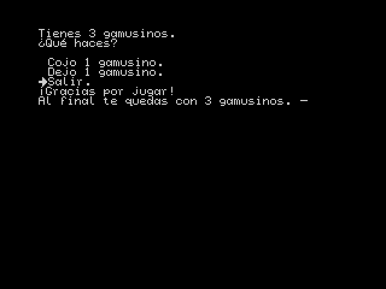

To do this we make a subroutine that performs this function:

```
[[LABEL ImprimirGamusinos]]You have [[PRINT @0]] gamusinos[[RETURN]]
```

We declare a label called `ImprimirGamusinos` that serves as a jump point. Then we have the printout of the number of gamusinos, and then the `RETURN` command. We make the call with `GOSUB ImprimirGamusinos` at the two points where we want it to be executed.

As I have already indicated, `GOSUB ImprimirGamusinos` makes a jump to the label `ImprimirGamusinos`, but with the exception that the point of the call to the subroutine is saved in the *stack*. Every subroutine must have a return point, that is, a completion point with which the engine is told to return to the point where we had left it, and that is done by the `RETURN` command, which recovers the last return point from the stack and jumps to that position.

One thing to note is that the subroutine is at the end, after `END`. This is so that it is not executed without us calling it explicitly. Please note that the interpreter does not differentiate a subroutine from "normal" code, and if it reaches that point it will execute it and do an invalid `RETURN` at the end. Therefore, I recommend avoiding these situations by placing subroutines at the end after an `END`, or using a `GOTO` before it to skip it in case you accidentally reach it.

And now, as usual, the clarifications and exceptions. Subroutines can be nested, that is, you can call a subroutine inside another. The return addresses will be stored in the stack in reverse order, but **BE CAREFUL, the stack has a limit**. This means you have a nesting limit. And as I explained in the previous paragraph, if you do a `RETURN` without a previous `GOSUB`, you will get at best an error, and at worst, erratic behavior.

To help you with this, the compiler follows the program's flow and warns you (`WARNING [CODEGEN]`, with the line) if a `RETURN` can be reached with no `GOSUB` pending, for example because the subroutine is entered with a `GOTO` or by running into it from the code above, and also if a subroutine can end without `RETURN`, leaving with a `GOTO` to the rest of the program. The latter is particularly treacherous: each time one level of the stack stays taken and, after a few hundred, the game hangs. If you want the game itself to check it while it runs, build with the `--debug-stack` option (in the GUI compiler, "Check the GOSUB stack at runtime").

Generally, the ideal time to call a subroutine is when you make a choice from a menu. So we've included the `OPTION GOSUB Label` variant, which will call the corresponding subroutine if that option is chosen. When it reaches the `RETURN` (always remember to end subroutines with it!), it will resume execution right after the `CHOOSE` of that option. With our new knowledge, let's fine-tune our code:

```
[[ /* Set screen colors and clear it */
   PAPER 0    /* Black background color  */
   BORDER 0   /* Black border color  */
   INK   7    /* White text color */
   PAGEPAUSE 1
   DECLARE 0 AS NumGamusinos
   SET NumGamusinos TO 0
   #Inicio
   CLEAR]]You have [[GOSUB ImprimirGamusinos]].
What do you do?

[[OPTION GOSUB Suma1]]I take 1 gamusino.
[[OPTION GOSUB Resta1]]I drop 1 gamusino.
[[OPTION GOTO Final]]Exit.
[[
   CHOOSE
   GOTO Inicio
   #Final]]Thanks for playing!
In the end you keep [[GOSUB ImprimirGamusinos]].[[
   WAITKEY
   END
   /* Gamusino printing subroutine*/
   #ImprimirGamusinos : PRINT @NumGamusinos]] gamusinos[[RETURN
   /* Addition subroutine*/
   #Suma1 : SET NumGamusinos TO @NumGamusinos + 1 : RETURN
   /* Subtraction subroutine */
   #Resta1 : SET NumGamusinos TO @NumGamusinos - 1 : RETURN
   ]]
```

---

## Conditional execution

In the following example we will use the `IF ... THEN ... ENDIF` structure to illustrate how it works:
Copy the following into `tutorial.cyd`:

```cyd
[[ /* Set screen colors and clear it */
   PAPER 0    /* Black background color  */
   BORDER 0   /* Black border color  */
   INK   7    /* White text color */
   PAGEPAUSE 1
   DECLARE 0 AS NumGamusinos
   SET NumGamusinos TO 0
   #Inicio
   CLEAR]]You have [[GOSUB ImprimirGamusinos]].
What do you do?

[[OPTION GOSUB Suma1]]I take 1 gamusino.
[[OPTION GOSUB Resta1]]I drop 1 gamusino.
[[ IF @NumGamusinos = 10 THEN
   OPTION GOTO Final]]Exit.
[[
   ENDIF
   CHOOSE
   GOTO Inicio
   #Final]]Thanks for playing!
In the end you keep [[GOSUB ImprimirGamusinos]].[[
   WAITKEY
   END
   /* Gamusino printing subroutine*/
   #ImprimirGamusinos : PRINT @NumGamusinos]] gamusinos[[RETURN
   /* Addition subroutine*/
   #Suma1 : SET NumGamusinos TO @NumGamusinos + 1 : RETURN
   /* Subtraction subroutine */
   #Resta1 : SET NumGamusinos TO @NumGamusinos - 1 : RETURN
   ]]
```

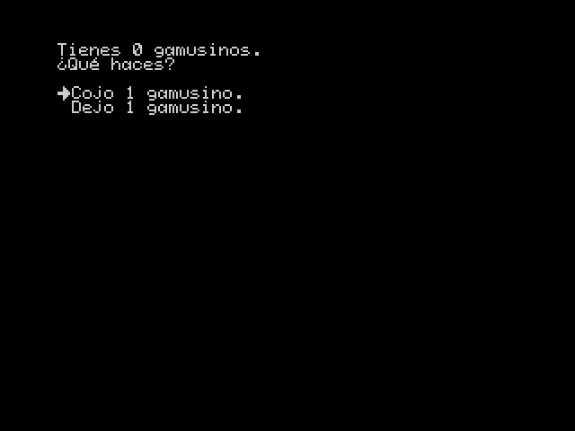

Funny... now we can't get out...

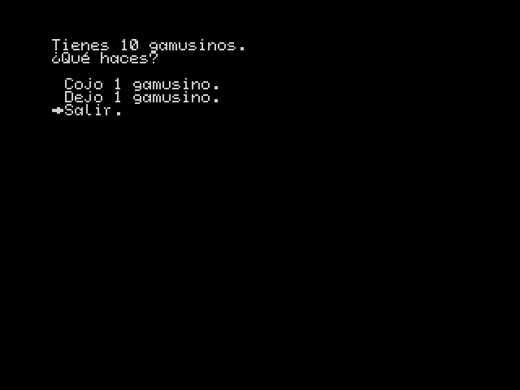

...until we have 10 gamusinos! What happens?

The answer is the `IF @NumGamusinos = 10 THEN ... ENDIF`: if the condition that we have 10 gamusinos is met, whatever is between the `THEN` and the `ENDIF` is executed, and otherwise it will skip it.

Note that not only the option command to exit is skipped; it also skips the text after it and, therefore, it does not show it either.

Now I am going to change to `IF @NumGamusinos = 10 THEN ... ELSE ... ENDIF`. What we do is add another block of code, which is executed if the condition is *NOT* met. In this case we are going to add another IF that tells us what we have to do:

```cyd
[[ /* Set screen colors and clear it */
   PAPER 0    /* Black background color  */
   BORDER 0   /* Black border color  */
   INK   7    /* White text color */
   PAGEPAUSE 1
   DECLARE 0 AS NumGamusinos
   SET NumGamusinos TO 0
   #Inicio
   CLEAR]]You have [[GOSUB ImprimirGamusinos]].
What do you do?

[[OPTION GOSUB Suma1]]I take 1 gamusino.
[[OPTION GOSUB Resta1]]I drop 1 gamusino.
[[ IF @NumGamusinos = 10 THEN
   OPTION GOTO Final]]Exit.
[[ ELSE IF @NumGamusinos < 10 THEN ]]
You need more gamusinos
[[ ELSE ]]
You have too many gamusinos
[[ ENDIF
   ENDIF
   CHOOSE
   GOTO Inicio
   #Final]]Thanks for playing!
In the end you keep [[GOSUB ImprimirGamusinos]].[[
   WAITKEY
   END
   /* Gamusino printing subroutine*/
   #ImprimirGamusinos : PRINT @NumGamusinos]] gamusinos[[RETURN
   /* Addition subroutine*/
   #Suma1 : SET NumGamusinos TO @NumGamusinos + 1 : RETURN
   /* Subtraction subroutine */
   #Resta1 : SET NumGamusinos TO @NumGamusinos - 1 : RETURN
   ]]
```

If we are below:

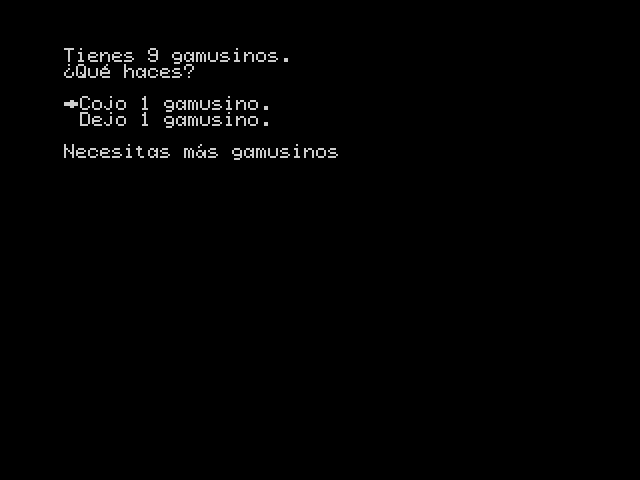

And if we are above:

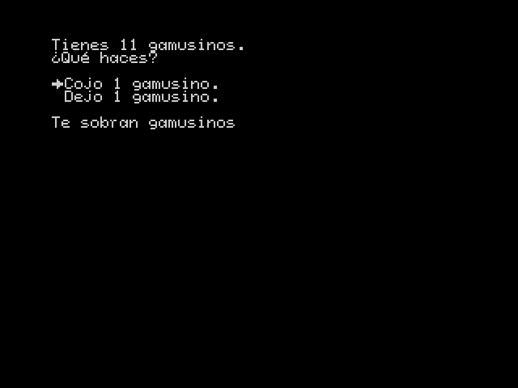

This allows us, along with `GOTO` and `GOSUB`, to control the **flow of the program**.

## Loops

To make certain parts of the code repeat while a condition is met we have `WHILE (cond) ... WEND`:

```
[[ /* Set screen colors and clear it */
   PAPER 0    /* Black background color  */
   BORDER 0   /* Black border color  */
   INK   7    /* White text color */
   PAGEPAUSE 1
]]We count up to 10:
[[
   DECLARE 0 AS cnt
   SET cnt TO 1
   WHILE (@cnt < 11)
      PRINT @cnt
      TAB 1
      SET cnt TO @cnt + 1
   WEND
]]
Done[[WAITKEY]]
```

In this example, I set the variable *cnt* to 1, and when the loop starts, it checks the condition that the variable is less than 11; as long as it is true, everything up to `WEND` is executed. Each time the loop is executed, we print the value of the variable, put a space with `TAB 1` and increment its value by 1. When it reaches 11, it stops executing and continues with whatever is after `WEND`.

And now it counts from 1 to 10:

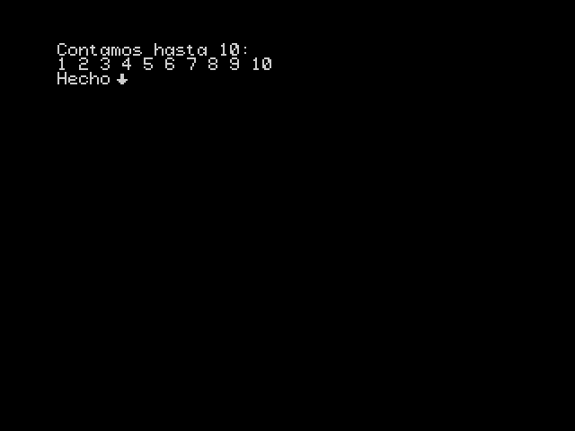

It is important to define the entry and exit conditions well, and to keep in mind that the verification of the loop condition is always done **at the beginning** of each iteration.

If we need the check to happen **at the end** instead, we have `DO ... UNTIL (cond)`, which repeats what is between `DO` and `UNTIL` **until** the condition is met. The same counter looks like this:

```cyd
[[
   DECLARE 0 AS cnt
   SET cnt TO 1
   DO
      PRINT @cnt : TAB 1
      SET cnt TO @cnt + 1
   UNTIL (@cnt > 10)
]]
```

Note that the condition is the other way round from the `WHILE`: there it repeats **while** `@cnt < 11`, and here **until** `@cnt > 10`. The other difference is that, since the condition is checked at the end, the body of a `DO ... UNTIL` always runs **at least once**: if `cnt` started at 20, the previous `WHILE` would print nothing, but this one would print 20 before leaving. It is useful, for example, to repeat a question until the answer is valid.

When all we want is to **count** (repeat something a fixed number of times with a changing counter), there is a handier way than building the `WHILE` by hand: the `FOR ... NEXT` loop. The previous example that counts from 1 to 10 becomes:

```cyd
[[
   DECLARE 0 AS cnt
   FOR cnt = 1 TO 10
     PRINT @cnt : TAB 1
   NEXT
]]
```

The counter (`cnt`) is written **bare** after `FOR` (as in `SET`/`LET`), and inside the body we read it with `@cnt`. The loop runs the counter from the start value to the end value, and `NEXT` marks the end of the body. If we want to count differently, we add `STEP` with the increment (it may be negative to count down):

```cyd
[[
   DECLARE 0 AS n
   FOR n = 10 TO 0 STEP -2   /* 10, 8, 6, 4, 2, 0 */
     PRINT @n : TAB 1
   NEXT
]]
```

`STEP` must be a fixed number (a constant), and the counter is a byte (0..255). Don't worry about the extremes: counting down to 0 or up to 255 works fine; it does not become an infinite loop.

With the addition of the loop, we can implement almost anything with the CYD language.

---

## Text compression and abbreviations

To save disk space, the compiler compresses the text, looking for the most common substrings in the text and replacing them with tokens or abbreviations.

When building the adventure, the compiler will look for abbreviations if it does not find a file named `tokens.json` in the project's folder, and will save the abbreviations found in a file with that name. On the other hand, if it finds such a file, it will use the abbreviations contained in it. To make it look for abbreviations again, simply delete the `tokens.json` file before building the adventure again.

The process of looking for abbreviations can be very time-consuming as the amount of text in the adventure increases. My advice is to write the adventure script *before* you start programming and put it all in a text file that you can feed to the compiler, so that it can generate a suitable abbreviation file. Once you have that, you can start adding commands to the text to shape the adventure. Once you have it *almost* finished, you can generate abbreviations again to see if you can carve out some more space.

---

## Organizing code with INCLUDE

As your adventure grows larger, managing all the code in a single file can become challenging. The `INCLUDE` directive allows you to split your adventure into multiple files, making it easier to organize and maintain your project.

### Basic usage

The `INCLUDE` directive lets you insert the contents of one CYD file into another during compilation:

```cyd
INCLUDE "filename.cyd"
```

For example, if you have a file called `variables.cyd` with all your variable declarations:

**variables.cyd:**
```cyd
[[
DECLARE 0 AS PlayerHealth
DECLARE 1 AS PlayerGold
DECLARE 2 AS HasSword
DECLARE 3 AS HasKey
]]
```

You can include it in your main file:

**main.cyd:**
```cyd
[[
INCLUDE "variables.cyd"
PAPER 0 : INK 7 : CLEAR
]]
You are in a dark dungeon...
```

When compiled, the preprocessor will automatically insert the contents of `variables.cyd` where the `INCLUDE` directive appears.

### Organizing a larger project

Here's a recommended structure for the project folder of a larger adventure:

```
my_adventure/
  ├── cyd_project.ini       # Project settings
  ├── main.cyd              # Main entry point
  ├── config/
  │   ├── variables.cyd     # All variable declarations
  │   └── settings.cyd      # Initial settings (colors, etc.)
  ├── lib/
  │   └── common.cyd        # Common subroutines
  └── chapters/
      ├── intro.cyd         # Introduction
      ├── chapter1.cyd      # Chapter 1
      ├── chapter2.cyd      # Chapter 2
      └── ending.cyd        # Ending sequences
```

The `IMAGES` and `TRACKS` folders, `SFX.ASM` and the rest of the game's files would also be in `my_adventure/`, and the compiled files in `my_adventure/OUTPUT/`. Since the main file is not named after the game, `cyd_project.ini` says so with `main = main.cyd`, and gives the game its name with `name = my_adventure`. The `lib/` folder here is the project's own: the libraries bundled with CYD are included with `INCLUDE LIB`, as we will see in the next section.

**Example main.cyd:**
```cyd
[[
/* Load configuration */
INCLUDE "config/variables.cyd"

/* Skip the subroutines: they only run when called with GOSUB */
GOTO Start

/* Load common functions */
INCLUDE "lib/common.cyd"

#Start
INCLUDE "config/settings.cyd"
INCLUDE "chapters/intro.cyd"
GOTO Chapter1

#Chapter1
INCLUDE "chapters/chapter1.cyd"

#Chapter2
INCLUDE "chapters/chapter2.cyd"

#TheEnd
INCLUDE "chapters/ending.cyd"
END
]]
```

Notice that the labels go inside the code block, as always: outside `[[ ]]`, `#Start` would be printed as text. Notice also the `GOTO Start` before including `lib/common.cyd`: the contents of an included file are placed right where the `INCLUDE` is, so, without that jump, execution would enter the first subroutine and reach a `RETURN` without having done any `GOSUB`.

**config/variables.cyd** and **config/settings.cyd:**
```cyd
[[
DECLARE 0 AS PlayerHealth
DECLARE 1 AS PlayerGold
]]
```

```cyd
[[
PAPER 0 : INK 7 : BORDER 0
SET PlayerHealth TO 100
SET PlayerGold TO 0
]]
```

### Practical example: common subroutines

Let's say you frequently show the player's status. Instead of repeating the code, create a subroutine file:

**lib/common.cyd:**
```cyd
[[
#ShowStatus
INK 6
]]Health: [[PRINT @PlayerHealth]] | Gold: [[PRINT @PlayerGold
INK 7
NEWLINE
RETURN

#GameOver
CENTER
INK 2
]]GAME OVER[[
INK 7
NEWLINE : NEWLINE
]]Press any key to restart...[[
WAITKEY
GOTO Start
]]
```

Remember that `PRINT` only prints numbers (the value of an expression); texts are written as they are, outside `[[ ]]`. `GameOver` doesn't come back with `RETURN`, but jumps to `Start` to begin again, so it is called with `GOTO` instead of `GOSUB`.

Then use it throughout your chapters:

**chapters/chapter1.cyd:**
```cyd
[[CLEAR]]You enter a dark corridor...
[[GOSUB ShowStatus]]
[[OPTION GOTO Door1]]Open the left door
[[OPTION GOTO Door2]]Open the right door
[[CHOOSE

#Door1
]]You found treasure!
[[SET PlayerGold TO @PlayerGold + 50
GOSUB ShowStatus
WAITKEY
GOTO Chapter2

#Door2
]]A trap! You lose health.
[[SET PlayerHealth TO @PlayerHealth - 20
IF @PlayerHealth <= 0 THEN
    GOTO GameOver
ENDIF
GOSUB ShowStatus
WAITKEY
GOTO Chapter2
]]
```

As in the rest of the tutorial, in `SET` the target variable goes without `@` (`SET PlayerGold TO ...`), and the `@` is only used to read its value (`@PlayerGold + 50`).

### Important features

- **Case-insensitive:** `INCLUDE`, `include`, and `Include` all work
- **Quotes:** Both `"file.cyd"` and `'file.cyd'` are supported
- **Relative paths:** A path is looked for next to the file containing the `INCLUDE`, and if it isn't there, from the project's root folder (the folder of the main script). So `chapters/chapter1.cyd` could also write `INCLUDE "config/variables.cyd"`
- **Libraries:** `INCLUDE LIB "strings.cyd"` includes one of the bundled libraries from wherever your adventure is (see the next section)
- **Nested includes:** Files can include other files (up to 20 levels deep)
- **Comments in CYD:** Use `/* */` for comments (`/* Load utilities */`), but on a line of their own: after the file name there can only be the `]]` that closes the code block, and anything else gives a syntax error. For the same reason, there can only be one `INCLUDE` per line.
- **Error detection:** Circular includes (A includes B, B includes A) are detected automatically

### Benefits

1. **Organization:** Keep related code together (all variables in one place, each chapter in its own file)
2. **Reusability:** Share common subroutines across multiple adventures
3. **Maintainability:** Find and fix bugs more easily in smaller, focused files
4. **Collaboration:** Multiple people can work on different files
5. **Testing:** Test individual chapters or components separately

### Tips for using INCLUDE

1. **Start simple:** Begin with a single file, then split into modules as the adventure grows
2. **Logical grouping:** Group related functions, variables, or story sections together
3. **Consistent naming:** Use clear, descriptive filenames like `chapter1.cyd` or `combat_functions.cyd`
4. **Directory structure:** Use subdirectories (`chapters/`, `lib/`, `config/`) to keep things organized
5. **Document dependencies:** Add comments explaining what each included file provides

---

## Using the bundled libraries

The `lib/` directory ships several **libraries written in the CYD language
itself**: collections of ready-to-use subroutines that do not modify the engine.
You add them with `INCLUDE LIB` and call them with `GOSUB`. Each library **skips over
itself** (an internal `GOTO`), so you just include it at the start of your
program; execution continues with your code and the routines only run when you
call them.

Each library reserves a small block of variables as its workspace, and the blocks
do not overlap, so you can use several at once. Don't use those numbers for
anything else in your program; if you do, the compiler warns you with a
`WARNING`:

- `lib/math16_32.cyd` (variables 224..254): 16- and 32-bit arithmetic.
- `lib/strings.cyd` (variables 216..223): text-string input and handling.
- `lib/sprites.cyd` (variables 200..211): masked sprites, covered in their own section below.
- `lib/sprites_px.cyd` (variables 200..212): the same sprites with pixel-precise X too; it is used instead of `lib/sprites.cyd`.

The manual has the full reference for every routine; here we will look at a couple
of practical cases.

### A score that does not fit in a byte

CYD variables are 8-bit (0..255), so a large score overflows quickly. With
`math16_32.cyd` we can compute it in 32 bits. Operands are loaded into "registers"
(groups of consecutive variables); wide values are loaded with `SET reg TO WORD n`
(16 bits) or `SET reg TO DWORD n` (32 bits), explained in
[Wide constants](#wide-constants-word-dword-and-strings), and a register is
copied into another with the multiple assignment `SET reg TO {...}`.

```cyd
[[
    INCLUDE LIB "math16_32.cyd"
    PAPER 0 : INK 7 : CLEAR

    /* enemies (1250) * points (800) = 1,000,000, without overflow */
    SET mlA0 TO WORD 1250      /* A = 1250 */
    SET mlB0 TO WORD 800       /* B = 800  */
    GOSUB mul1632              /* C = A * B (32-bit result) */

    /* + bonus (234567) */
    SET mlA0 TO {@mlC0, @mlC1, @mlC2, @mlC3}   /* A = C */
    SET mlB0 TO DWORD 234567                   /* B = 234567 */
    GOSUB add32                                /* A = 1234567 */
]]Total score: [[ GOSUB print32 ]][[
    WAITKEY : END
]]
```

You can see this full example in `examples/math_library`.

### Asking for the player's name

With `strings.cyd` reading a string from the keyboard is very simple. You only
need to tell it where the buffer is (`stBase`) and its capacity (`stLen`);
`strInput` handles the cursor, deletion with DELETE and ending with ENTER.

```cyd
[[
    INCLUDE LIB "strings.cyd"
    PAPER 0 : INK 7 : CLEAR

    SET stBase TO 0 : SET stLen TO 16   /* buffer in variables 0..15 */
    GOSUB strInput
]]Hello, [[ GOSUB strPrint ]]!
[[
    GOSUB strLen
]]Your name has [[ PRINT @stRes ]] letters.[[
    NEWLINE : WAITKEY : END
]]
```

You can see this full example in `examples/strings_library`.

---

## Workflow

From this point on, you should have enough knowledge to be able to tackle your own adventure. From here on, I cannot give you advice on how to write your adventure; that is up to your imagination. However, I am going to recommend a workflow based on the experience of developing the adventure *The Rings of Saturn*, which I submitted to the Radastán 2023 Adventure Contest.

### GUI compiler alternative

Instead of running the `make_adv` scripts and editing `cyd_project.ini` by hand, you can use the **make_adventure_gui** tool, which provides a graphical interface for compiling your adventures.

**Launching the GUI:**

**Windows:**
```batch
make_adventure_gui.cmd
```

**Linux/macOS:**
```bash
./make_adventure_gui.sh
```

The GUI works on projects: in its **Project** frame, the **New…** button creates one with a short adventure to start from, **Open…** opens the folder of an existing one (such as our `tutorial` folder or any of the examples), and **Recent** lists the last ones; the last project is opened again when the GUI starts. It allows you to configure all compilation options (target, paths, image lines, abbreviation settings, and more) without touching any scripts, and it saves them in the project's `cyd_project.ini`. Once configured, you can compile your adventure with a single click of the **Compile** button. The GUI will display detailed compilation messages and automatically open the compiled file in your chosen emulator if configured.

This approach eliminates the need to understand batch or shell scripts, making the compilation process more accessible for users who prefer graphical interfaces.

My first recommendation is to write the bulk of your adventure **before** you start programming it, as you will have already read in the previous chapter. With that, you will have a valid list of abbreviations to start working on, since the process of searching for abbreviations is **very time-consuming**. To give you an idea, compressing the entire *The Rings of Saturn* (a book of about 150 pages) takes up to three quarters of an hour. In addition, our workflow is essentially going to consist of writing, compiling and testing over and over again, so we are interested in making this process as fast as possible.

You can write your adventure with your favorite text editor, but always **in plain text**, since that is what the compiler understands.

An important issue when working with the editor is the encoding of the texts. A file on the disk is an ordered collection of bits with a name; the computer does not "know" what to do with those bits; it is the programs that interpret those bits.

A text file is a file whose bits represent characters. The way of interpreting those characters is called **encoding**. The most famous encoding used since the beginning of computing is **ASCII**, whose standard supports 128 characters, designed for the English language and with extensions to 256 for international and special characters. Today, ASCII has become too small, and the encoding used as standard by all current text editors by default is **UTF-8**.

All current editors support multiple encodings, so you will have to investigate the operation of your editor to select the correct encoding.

The **CYD** compiler supports UTF-8 text, but you have to take into account a number of limitations when writing your text or copying it from another source. The default character set of the engine is the following:

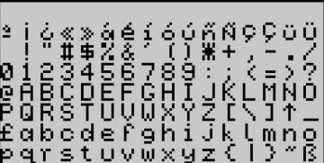

Those are the characters you have available, and UTF-8 has *millions* of different characters, and I'm not exaggerating, so most of them will make the compiler fail. In the manual I detail the only characters that will be translated from UTF-8 to the encoding used by the engine:

| Character| Position |
| -------- | -------- |
| 'ª'      | 16       |
| '¡'      | 17       |
| '¿'      | 18       |
| '«'      | 19       |
| '»'      | 20       |
| 'á'      | 21       |
| 'é'      | 22       |
| 'í'      | 23       |
| 'ó'      | 24       |
| 'ú'      | 25       |
| 'ñ'      | 26       |
| 'Ñ'      | 27       |
| 'ü'      | 28       |
| 'Ü'      | 29       |

As you can see, for example, the accented uppercase vowels are not there. The compiler will automatically transform the accented uppercase letters into unaccented uppercase letters.

Once you have written a good part of your adventure, and obtained an abbreviation file, we can start programming it.

My recommendation is to use the "divide and conquer" tactic, a technique that consists of dividing a problem to be solved into smaller subproblems that we will solve little by little. In our context, it means that we should divide the adventure into sections that we will program one by one. You have probably already instinctively done this step when writing your story, dividing it into chapters.

With this subdivision, we will now work with two source files, a *global file* with the text of the "complete" adventure, and another that we will pass to the compiler with the section that we are going to program, which we will call *working file*. The process consists of the following steps:

1. Copy one of the uncompleted sections from the global file to the working file.
2. Add the commands to the text of the working file and format it if necessary.
3. Compile the working file.
4. Run the resulting image in an emulator and test.
5. If you are not satisfied, modify the file and return to step 3.
6. When you have the complete section, copy the completed section in the working file and replace it in the global file.
7. If you still have sections to complete, return to step 1.
8. Move the entire global file to the working file.

However, once you have completed the adventure, you will probably have to fix things, compile and test again. And, depending on the length of the adventure, getting to the relevant part can be hell. I will suggest several techniques to avoid this.

One tactic we can employ is to label the beginning of each and every section with `LABEL` (we would do this in the previous process). Then, we simply put a `GOTO` to the label of the section we want to test at the beginning of the adventure. When the adventure runs, it jumps straight to that section, saving us precious time. Remember to remove the initial `GOTO` afterwards!

Another technique I have employed is to cancel pauses. To do this, I use the compiler's ability to use comments within code sections. Using our text editor, we can replace all occurrences of the `WAITKEY` command, for example, with the text `/*WAITKEY*/`. When we compile again, since those commands are commented out, they will not be executed and everything will be displayed non-stop. When we want to undo the change, we do the opposite process, replacing `/*WAITKEY*/` with `WAITKEY`. To speed up this process even further, we can even introduce the commands commented out in the previous phase.

Finally, almost all modern emulators offer the possibility of speeding up the execution. We can take advantage of this to display the text faster than usual.

I hope these techniques help you create your adventure in the most comfortable way possible. Programming is an iterative process of writing, compiling, running and testing, and it can be monotonous, but also very satisfying when we get the desired result.

---

## Side-scrolling menus

Option menus also allow *side-scrolling* and the `MENUCONFIG` command allows you to configure this behavior.
First, it should be noted that everything explained earlier in the tutorial is still applicable, but it has become a special case that we will detail.
Without going into too many technical details of the engine, we will explain how the menu system works now.

The menu system is based on a list of options. Each time we declare an option, the screen position (adjusted to 8x8 coordinates) and the corresponding jump address are saved in the list, so that the options are saved in the same order in which we declared them.
When the screen is cleared or an option is chosen from the menu, the list is cleared.

When you activate the menu with `CHOOSE`, a pointer corresponding to the selected option is placed in the first position of the list, and the corresponding option in the list shows the selection icon in the stored screen position. When you scroll through the menu with the keys, you move that pointer along the list, and at each step, the on-screen pointer moves to the corresponding position.

In previous versions, you were only allowed to move one position forward in the list with the *A* key and one position backward with the *Q* key. Because of this key layout, you were expected to have vertical menus.

Now you are allowed to use the *O* and *P* keys to scroll *"horizontally"*. In fact **CYD** has no concept of horizontality and verticality, it simply scrolls through the list in a certain way according to the keys pressed. Thanks to the command `MENUCONFIG x,y` you can configure this behavior. The command admits two parameters that mean the following:

- The first parameter (which we will call `X`) determines the increment or decrement of the selected option number when you press **P** and **O** respectively.
- The second parameter (which we will call `Y`) determines the increment or decrement of the selected option number when we press **A** and **Q** respectively.

That is, if the selected option number at a given time is `N`, then:

- When we press **O**, `N` becomes `N - X`.
- When we press **P**, `N` becomes `N + X`.
- When we press **Q**, `N` becomes `N - Y`.
- When we press **A**, `N` becomes `N + Y`.

With this we can make different types of movements, but it is our responsibility to place the options in the correct order and position on the screen so that it is consistent with the keystrokes.

Let's see it, as always, with the following example:


```
[[
    PAGEPAUSE 1
    BORDER 0
    INK 7
    BRIGHT 1
    FLASH 0
    PAPER 0
    MENUCONFIG 1,2
    CLEAR
]]Choose an option:

[[OPTION GOTO Opcion1]]First option.  [[OPTION GOTO Opcion2]]Second option.
[[OPTION GOTO Opcion3]]Third option.  [[OPTION GOTO Opcion4]]Fourth option.
[[OPTION GOTO Opcion5]]Fifth option.   [[OPTION GOTO Opcion6]]Sixth option.

[[
    CHOOSE
    LABEL Opcion1]]You chose option 1.[[
    GOTO Siguiente
    LABEL Opcion2]]You chose option 2.[[
    GOTO Siguiente
    LABEL Opcion3]]You chose option 3.[[
    GOTO Siguiente
    LABEL Opcion4]]You chose option 4.[[
    GOTO Siguiente
    LABEL Opcion5]]You chose option 5.[[
    GOTO Siguiente
    LABEL Opcion6]]You chose option 6.[[
    LABEL Siguiente
    WAITKEY : END]]
```

According to what we have explained, when using `MENUCONFIG 1,2`, then when we press **O** and **P**, the selected option is decremented and incremented by 1, and when we press **Q** and **A**, the selected option is decremented and incremented by 2. That is asking us for a menu with two elements per row, since when we press *down* or *up*, we jump two at a time. With this, we must take care of placing the options in two columns and in order from left to right.

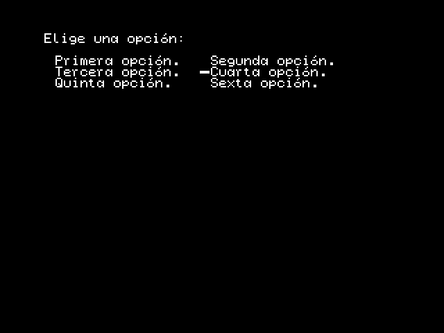

The default behavior, which simulates the *vertical* behavior of previous versions, is done with `MENUCONFIG 0,1`. That is, when we press **O** and **P**, the selected option is decremented and incremented by 0, that is, **it does nothing**, it does not move. And when you press **Q** and **A**, the selected option is decremented and incremented by 1, so we have a strictly vertical menu.

Thus, just as `MENUCONFIG 0,1` gives us a vertical menu in one column, `MENUCONFIG 1,0` gives us a horizontal menu in one row. With `MENUCONFIG 1,3` we will have a three-column menu, etc. But remember that `MENUCONFIG` indicates not the arrangement of the options (we define that when we declare them) but the behavior of the keys.

In this case, it is better to try the example live and experiment on your own. Keep in mind that the pointer will never go below zero or above the number of options in the list. Therefore, you should enter *reasonable* values or the menu will not work well.

---

## Menu keys and joystick

Menus are used with **Q**, **A**, **O** and **P**, and you select with **SPACE**. Many Spectrum games let the player choose their keys and their joystick, and CYD allows it with two commands: `MENUKEY` changes a key and `MENUJOY` chooses a joystick. The `examples/menu_keys` example is a short program that does both; here we look at it piece by piece.

Before starting, it helps to know what always works, whatever is changed: the cursor keys, **ENTER** to select and the Kempston joystick. So even if the player sets up their keys badly, they can never be left unable to use the menu.

### Redefining the keys

`MENUKEY` takes the action and the key. The actions are 0 up, 1 down, 2 left, 3 right and 4 select, so the example names them with `CONST`:

```
[[
    CONST Arriba = 0
    CONST Abajo = 1
    CONST Izquierda = 2
    CONST Derecha = 3
    CONST Seleccionar = 4
]]
```

The key is the code `INKEY` returns. To ask the player for it, the easiest way is `INKEY(0)`, which waits for a key to be pressed. The example goes through the five actions with the variable `accion`, writes the name of each one and applies the key the player presses:

```
[[
#Redefinir
    CLEAR
    ]]Pulsa la tecla de cada acción.

[[
    LET accion = Arriba
#SiguienteTecla
    IF @accion = Arriba THEN
        ]]Arriba: [[
    ELSEIF @accion = Abajo THEN
        ]]Abajo: [[
    ELSEIF @accion = Izquierda THEN
        ]]Izquierda: [[
    ELSEIF @accion = Derecha THEN
        ]]Derecha: [[
    ELSE
        ]]Seleccionar: [[
    ENDIF
#PideTecla
    LET tecla = INKEY(0)
    /* ENTER y las flechas (códigos menores que 32) ya funcionan siempre */
    IF @tecla < 32 THEN
        GOTO PideTecla
    ENDIF
    MENUKEY @accion, @tecla
    IF @tecla = 32 THEN
        ]]ESPACIO[[
    ELSE
        CHAR @tecla
    ENDIF
    NEWLINE
    LET accion = @accion + 1
    IF @accion <= Seleccionar THEN
        GOTO SiguienteTecla
    ENDIF
    GOTO Hecho
]]
```

Note three details:

- Codes below 32 (ENTER, the cursor keys...) are refused, as they already have their job and always work.
- `CHAR` writes the chosen key, except the space, which would not be seen and is written by its name.
- The keys are not kept in variables: `MENUKEY` keeps them in the interpreter. The variables `tecla` and `accion` are only needed while the screen lasts, and the keys are not saved with the game either, so loading a game does not change the player's controls.

This version does not stop the player from putting the same key in two actions (that key would then do both). The controls screen of `examples/Delerict` does check it: it keeps the keys in an array while it asks for them and refuses the repeated ones.

To go back to the usual keys, just set them again:

```
[[
#Originales
    MENUKEY Arriba, 'q'
    MENUKEY Abajo, 'a'
    MENUKEY Izquierda, 'o'
    MENUKEY Derecha, 'p'
    MENUKEY Seleccionar, ' '
]]
```

### Choosing the joystick

To the Spectrum, Sinclair and cursor joysticks are keys of the keyboard: the Sinclair on port 1 presses the keys 6 to 0, the one on port 2 the keys 1 to 5, and the cursor joystick the keys 5 to 8 and 0. As they use the same keys with different meanings, the player has to say which one they have, and that is what `MENUJOY` does: 0 none, 1 Sinclair on port 1, 2 Sinclair on port 2 and 3 cursor.

```
[[
#Joystick
    CLEAR
    MENUCONFIG 0, 1
    ]]¿Qué joystick tienes?

[[
    OPTION GOTO SinJoystick
]] Ninguno o Kempston
[[
    OPTION GOTO Sinclair1
]] Sinclair, puerto 1
[[
    OPTION GOTO Sinclair2
]] Sinclair, puerto 2
[[
    OPTION GOTO Cursor
]] De cursor[[
    CHOOSE
#SinJoystick
    MENUJOY 0
    GOTO Hecho
#Sinclair1
    MENUJOY 1
    GOTO Hecho
#Sinclair2
    MENUJOY 2
    GOTO Hecho
#Cursor
    MENUJOY 3
    GOTO Hecho
]]
```

The chosen joystick works at the same time as the keyboard keys, the usual ones or the redefined ones. The Kempston joystick does not need to be chosen: it is read separately and always works.

### Trying it

The example also has a 3×3 grid of numbers (`MENUCONFIG 1, 3`) to try the four directions and the select key, and it says which number was chosen with `OPTIONVAL()`. Build it, redefine the keys or choose a joystick, and try the grid with the new controls.

---

## Copying image fragments to screen

If you have followed the tutorial in order, you will already know that with the command `PICTURE` we load an image into the screen buffer, and with `DISPLAY` we display it, that is, it is copied from the buffer to the screen, but always in full screen. But it is also possible to copy a piece of the image loaded in the buffer to a certain defined position on the screen using the command `BLIT`.

But first, let's create the following SCR image with some graphical editor for the Spectrum:

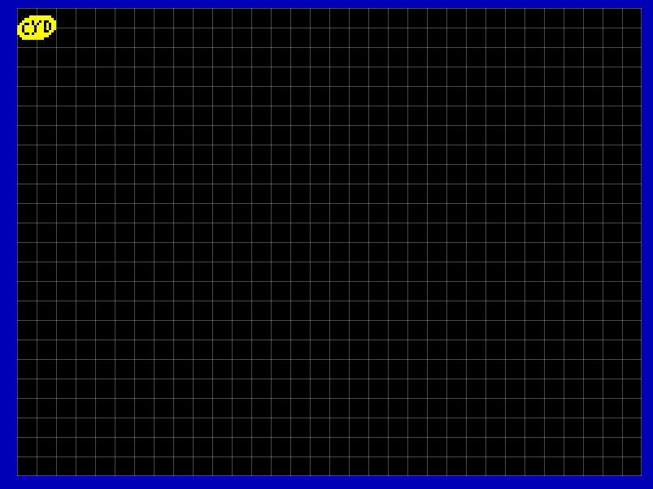

And we leave it in the `IMAGES` folder of the project. You can see that we have drawn in the first block of 16x16 pixels, or, in other words, 2x2 characters.

Now, let's use the following example:

```
[[
    INK 7
    PAPER 0
    BORDER 1
    CLEAR
    PICTURE 0            /* Loading image 0 into the buffer */
    DECLARE 0 AS row     /* Variable for rows */
    DECLARE 1 AS col     /* Variable for columns */
    SET row TO 0
    WHILE (@row < 24)
        SET col TO 0
        WHILE (@col < 32)
            BLIT 0, 0, 2, 2 AT @col, @row /* Copying to screen */
            SET col TO @col+2
        WEND
        SET row TO @row+2
    WEND
    AT 31, 23
    WAITKEY
    END]]
```

This example basically clears the screen and loads image 0 into the screen buffer (the one we created earlier), and then we go through the rows from 0 to 24 and the columns from 0 to 32, jumping two characters at a time. If you've followed this tutorial, you won't have any trouble understanding how it works.

The key component is the command `BLIT 0, 0, 2, 2 AT @col, @row`. What we're telling the engine is "take the rectangle from the buffer with origin (0,0) and size 2x2 characters and copy it to the screen at the position defined by the variables col and row". Since we are traversing the entire screen using two nested loops, the result is the following:

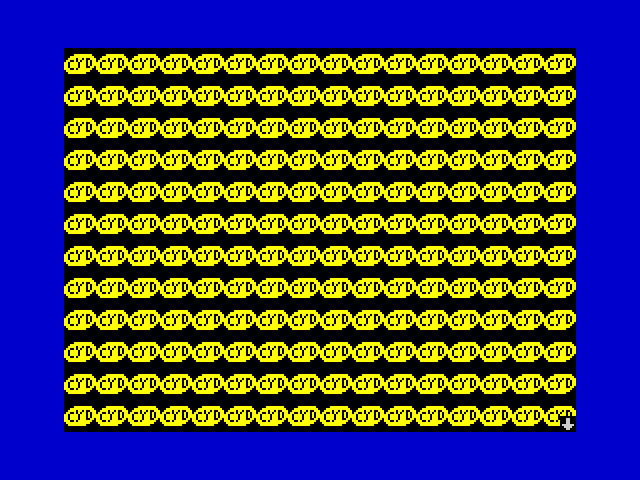

In general, with `BLIT x_orig, y_orig, width, height AT x_dest, y_dest`, what we do is copy from the image loaded in the buffer a piece of it defined by the first 4 parameters, and we copy it to the screen position given by the last two. This gives us many possibilities to build the image on the screen using "tiles", create animations, wipes, etc.

As final notes, three things to highlight:

- All the parameters accept variables or expressions, not only the last two as in this example: the rectangle to be cut can also be computed.
- In all parameters, the unit is the 8x8 pixel character.
- The implementation is slow because it is generic, so if you are tempted to use it as "sprites", the results will be disappointing due to flickering. That is what the sprites library is for, covered in the [Masked sprites](#masked-sprites) section.

### Strict colon mode (syntax enforcement)

As of version 1.2.x, the compiler enforces **Strict Colon Mode by default**. This means that when you write multiple statements on the same line, they **must** be separated by colons (`:`).

**Correct Syntax:**
```cyd
[[ SET 0 TO 10 : SET 1 TO 20 : PRINT @0 + @1 ]]
```

**Incorrect Syntax (will fail):**
```cyd
[[ SET 0 TO 10 SET 1 TO 20 PRINT @0 + @1 ]]
```

However, when statements are on separate lines, colons are **optional**:

```cyd
[[
SET 0 TO 10
SET 1 TO 20
PRINT @0 + @1
]]
```

**Key points:**
- Line breaks automatically separate statements, making colons unnecessary when using new lines
- If you prefer the old behavior (without strict colon mode), you can use the `--no-strict-colons` flag with the compiler
- Strict Colon Mode improves code readability and prevents accidental statement concatenation
- The compilation process enforces this rule consistently across all your adventure files

---

## Masked sprites

As we have seen, `BLIT` copies a rectangle from the buffer to the screen as it is: whatever was underneath disappears. For a character or an object moving over a scene we need something else: it should cover only its silhouette, with the background still showing around it. That is a *masked sprite*, and we have it in the `lib/sprites.cyd` library.

We need two pictures: the scene and a "sheet" with the sprites. On the sheet, next to each sprite (beside it or below) we draw its **mask**: the silhouette of what it covers, in ink. If the mask is one pixel bigger than the sprite all round, the sprite gets a thin outline in the paper color, which helps to tell it from the background.

To draw a sprite, we tell the library where the sprite and its mask are in the buffer, its size and where we want it on screen, all in characters as with `BLIT`, and call `sprDraw`:

```
[[
    INCLUDE LIB "sprites.cyd"
    PICTURE 0 : DISPLAY 1    /* the scene, on screen */
    PICTURE 1                /* the sprite sheet, into the buffer (not shown) */
    SET sprX TO 0 : SET sprY TO 0       /* the sprite on the sheet */
    SET sprW TO 2 : SET sprH TO 3       /* its size */
    SET sprMX TO 0 : SET sprMY TO 3     /* its mask, 3 rows below */
    SET sprDX TO 14 : SET sprDY TO 15   /* where we want it */
    GOSUB sprDraw
    WAITKEY
    END
]]
```

Note the trick with the two pictures: `DISPLAY` puts the scene on screen and then `PICTURE 1` loads the sprite sheet into the buffer **without touching the screen**. From then on, the library's routines copy from the buffer to the screen whatever we ask them to.

By default the sprite doesn't change the screen's colors: it takes the ink of each cell of the scene, which avoids color clash. If you want it to use its own colors, do `SET sprAttr TO 1`.

### Moving sprites

To move a sprite you have to erase it before drawing it in its new position, and "erasing" here means putting back the scene that was underneath. That is what `sprSave` is for, saving what is on screen where the sprite is going, and `sprRestore`, putting it back where it was. Every step of the animation does the same:

```
    #Step
    GOSUB sprRestore             /* erase the sprite: the background returns */
    SET sprDX TO @sprDX + 1      /* move it */
    GOSUB sprSave                /* save the background at the new position */
    GOSUB sprDraw                /* and draw it on top */
    WAIT 3
    GOTO Step
```

(The first time `sprRestore` does nothing, since nothing has been saved yet.)

To animate it while it walks, just point `sprX` at the next frame of the sheet each step.

Two more details:

- The horizontal position goes by characters, but the vertical one can be set with pixel precision using `sprPY`, which is added to `sprDY`. To make something go up and down smoothly, leave `sprDY` at 0 and use `sprPY` as the height in pixels (0 to 191). If you need pixel precision horizontally too, include `lib/sprites_px.cyd` instead of `lib/sprites.cyd`: it has the same routines plus `sprPX`, which is added to `sprDX`. In exchange it takes about 490 bytes more and draws sprites that don't fall on a character boundary more slowly. The `examples/sprites_px` example is the one below with the character walking pixel by pixel.
- If several sprites move at once, each one needs its own slot to save its background: it is chosen with `sprSlot` (0 to 3). And they must be restored **in the reverse order they were saved**; otherwise, when two sprites cross, one would put back a background that already includes the other.

In `examples/sprites` there is a complete example with both: a character walking by characters and a ball bouncing pixel by pixel, each in its own slot:

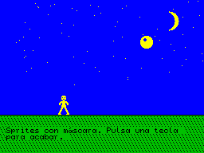

The library takes a little over 1 KB, but only if you use it: if you call none of its routines, the compiler includes nothing. The manual has the complete reference of the routines and their parameters.

---

## Reading the keyboard, variable arrays and indirections

First, I'll warn you that this is a fairly advanced chapter that introduces some rather advanced programming concepts if you've never programmed before. If you don't understand it, you can skip it without any problems.

There are a series of commands that allow reading characters from the keyboard and deleting them on the screen, and, together with indirection, they allow us to store text strings in variables and use them as arrays. However, **BE CAREFUL**, we only have 256 variables available... This means that we can't store very long text strings, but we can use them to store a short one, like the name of our protagonist or to create a simple command line.

Let's see it with the following example:

```cyd
[[ /* Set screen colors and clear it */
   PAPER 0    /* Black background color  */
   INK   7    /* White text color */
   BORDER 0   /* Black border color  */
   CLEAR      /* Clear the screen*/
   PAGEPAUSE 1

   DECLARE 0 AS str        /* Start of the 16-character array */
   DECLARE 16 AS ptr       /* Current pointer over the string */
   DECLARE 17 AS chr       /* Character read from keyboard */

]]Enter your name:[[
   GOSUB inputStr]]
Welcome [[
   GOSUB printStr
   NEWLINE /* Line break */
   WAITKEY
   END

   /* Subroutine to print a 16-character string*/
   #printStr
   /* Initialize the pointer with the address of the string's first variable */
   SET ptr TO @@str
   /*
   While the pointer is less than its own address...
   (The address serves as a marker to indicate the end of the string)
   */
   WHILE (@ptr < @@ptr)
      /* If the content of the variable marked by the pointer is zero, we finish */
      IF [@ptr] = 0 THEN RETURN ENDIF
      /* Print the character using indirection on the pointer */
      CHAR [@ptr]
      /* Increment the pointer one position */
      SET ptr TO @ptr + 1
   WEND
   RETURN

   #inputStr
   /* Initialize the pointer with the address of the string's first variable */
   SET ptr TO @@str
   /* Fill the whole string with zeros */
   WHILE (@ptr < @@ptr)
      SET [ptr] TO 0
      SET ptr TO @ptr + 1
   WEND
   /* Put the pointer back at the beginning */
   SET ptr TO @@str
   /* Infinite loop */
   WHILE ()
      /* Put the '_' character as cursor */
      CHAR 95
      /* Read a pressed key and store its ASCII code in chr */
      SET chr TO INKEY()
      /* Erase the cursor */
      BACKSPACE
      /* If the key is ENTER, we exit */
      IF @chr = 13 THEN RETURN ENDIF
      /* If the key is DELETE... */
      IF @chr = 12 THEN
         /* Set the current pointer position to zero, if we are not at the end of the array */
         IF @ptr < @@ptr THEN
            SET [ptr] TO 0
         ENDIF
         /* If we are not at the beginning of the array... */
         IF @ptr > @@str THEN
            /* Erase the current position on screen and go back */
            BACKSPACE
            /* Move the pointer to the previous position */
            SET ptr TO @ptr - 1
            /* Fill it with zero as well */
            SET [ptr] TO 0
         ENDIF
      ELSE
         /*
         If the character is greater than 32 and less than 128 (printable ASCII characters)
         and we are not at the end of the array...
         */
         IF @chr >= 32 AND @chr < 128 AND @ptr < @@ptr THEN
            /* Print the character */
            CHAR @chr
            /* Store the character in the array */
            SET [ptr] TO @chr
            /* Advance the pointer */
            SET ptr TO @ptr + 1
         ENDIF
      ENDIF
   WEND
]]
```

As always, if we try it:

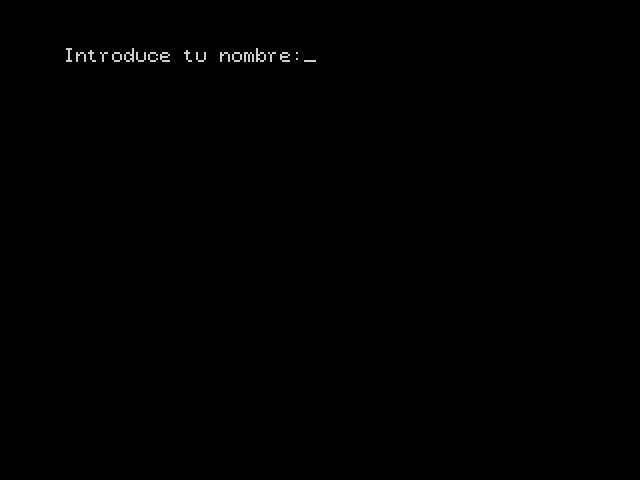

A "command line" appears where we can type; with **ENTER** we validate, and with **DELETE** we can delete the last character we have typed. You will notice, if you play with the program, that if we exceed 16 characters, it does not let us enter more, and only allows us to delete the last character or press **ENTER**. If we do the latter:

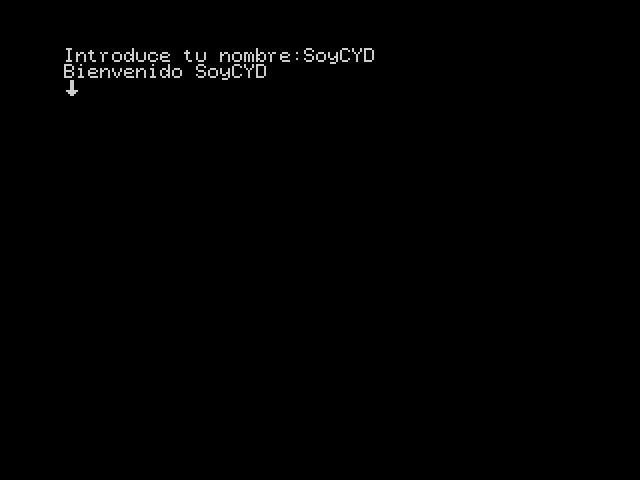

It prints the string we have entered! In this simple way, we already have a couple of subroutines that we can use to read and print small text strings. The comments included are enough to know what it is doing at each step, but there are some fairly complex concepts that we need to consolidate; so this section will have, exceptionally, subsections.

### Indirection

In the example code you will have seen that variables are placed in square brackets, for example `SET [ptr] TO 0`. This is called **indirection**, and what it means is that **the result of the expression inside the square brackets is used as the pointer to the variable to be accessed**. It allows us to create **pointers** and implement **arrays**.

The difference between `SET 1 TO 0` and `SET [1] TO 0` is that the first command means *"store zero in variable 1"*, and the second means *"store zero in the variable whose number corresponds to the content of variable 1"*. So, if in variable 1 we had a two, then it will store zero in variable 2. In this case, we are using variable number 1 as a *pointer*, since variable 1 *points* to another variable.

Let's look at an example. We want to fill variables 0 through 7 with zeros, using variable number 8 as a pointer.
The code to do this would be as follows:

```cyd
[[
SET 8 TO 0
WHILE (@8 < 8)
   SET [8] TO 0
   SET 8 TO @8 + 1
WEND
]]
```

In the first line we initialize the pointer to 0 with `SET 8 TO 0`, which would give us this situation:

```text
       0 1 2 3 4 5 6 7 8
      +-+-+-+-+-+-+-+-+-+-
      | | | | | | | | |0|...
      +-+-+-+-+-+-+-+-+-+-
```

Once inside the loop, we see that we have `SET [8] TO 0`, which indicates that in the variable whose index corresponds to the value of the content of variable 8, we will save the value zero:

```text
       0 1 2 3 4 5 6 7 8
      +-+-+-+-+-+-+-+-+-+-
      |0| | | | | | | |0|...
      +-+-+-+-+-+-+-+-+-+-
       ^               |
       |               |
       +---------------+

```

The next step is to increment the pointer by one (`SET 8 TO @8 + 1`):

```text
       0 1 2 3 4 5 6 7 8
      +-+-+-+-+-+-+-+-+-+-
      |0| | | | | | | |1|...
      +-+-+-+-+-+-+-+-+-+-
```

Since the value of variable 8 is still less than 8, we execute `SET [8] TO 0` again and save 0 in variable 1:

```text
       0 1 2 3 4 5 6 7 8
      +-+-+-+-+-+-+-+-+-+-
      |0|0| | | | | | |1|...
      +-+-+-+-+-+-+-+-+-+-
         ^             |
         |             |
         +-------------+

```

We increase again:

```text
       0 1 2 3 4 5 6 7 8
      +-+-+-+-+-+-+-+-+-+-
      |0|0| | | | | | |2|...
      +-+-+-+-+-+-+-+-+-+-
```

This process is executed until the loop condition is no longer met, which would result in this:

```text
       0 1 2 3 4 5 6 7 8
      +-+-+-+-+-+-+-+-+-+-
      |0|0|0|0|0|0|0|0|8|...
      +-+-+-+-+-+-+-+-+-+-
```

So far I have used numerical names for variables. But how would we do it with variable name declarations?

```cyd
[[
DECLARE 0 AS array
DECLARE 8 AS ptr

SET ptr TO 0
WHILE (@ptr < 8)
   SET [ptr] TO 0
   SET ptr TO @ptr + 1
WEND
]]
```

The previous example could work... but if we decide to move the array and its pointer to other variables we will have a problem because in addition to the declarations, we would have to change `SET ptr TO 0` and `WHILE (@ptr < 8)` as well. But we have the following possibility:

```cyd
[[
DECLARE 0 AS array
DECLARE 8 AS ptr

SET ptr TO @@array
WHILE (@ptr < @@ptr)
   SET [ptr] TO 0
   SET ptr TO @ptr + 1
WEND
]]
```

You will notice that instead, we are using the variable names with two @ signs `@@`. As you may know, when we find an @ sign inside an expression, it indicates that we are going to access the content of the corresponding variable. Well, the two @ signs indicate that we are going to use **the variable number** in the expression. So in the previous example `@@array` will be 0 and `@@ptr` will be 8. On the other hand, if we did the following, `@@array` would be 8 and `@@ptr` would be 16:

```cyd
[[
DECLARE 8 AS array
DECLARE 16 AS ptr

SET ptr TO @@array
WHILE (@ptr < @@ptr)
   SET [ptr] TO 0
   SET ptr TO @ptr + 1
WEND
]]
```

It also allows us to access individual elements of the array. For example, to print the value of the fourth position of the array, assuming *array* is variable 0:

```text
       0 1 2 3 4 5 6 7
      +-+-+-+-+-+-+-+-+-
      |0|0| |4| | | | |...
      +-+-+-+-+-+-+-+-+-
             ^
```

we would use `PRINT [@@array + 3]`, and it would print 4. Remember that arrays are counted from zero, not from one. Another way to look at the `@@` operation is as the inverse of `[]`, so that `PRINT [@@array]` would be equivalent to `PRINT @array`.

This is a pretty advanced concept for someone who has never programmed before. I've tried to give a simple explanation, but if you don't understand it, it's normal and not necessary to make an interesting adventure, but if you do understand it, it can give you a powerful tool.

With these concepts in place and with the comments, you can understand how the first example works.

### Reading the keyboard (INKEY)

To read a pressed key, we have the `INKEY()` function, which returns the code of the pressed key. This function works the same as its equivalent in Sinclair BASIC, but with the exception that the BASIC version returns zero if there is no valid key pressed, while the default behavior in CYD is to wait for a valid key to be pressed. If we want to reproduce the behavior of Sinclair BASIC, we can do so by using `INKEY(1)`.

The value returned when a key is pressed corresponds (normally) to its **[ASCII](https://es.wikipedia.org/wiki/ASCII)** value, but adapted to the **[Sinclair](https://en.wikipedia.org/wiki/ZX_Spectrum_character_set)** version.

In the initial example, we check if the value of the returned key is 13 (ENTER) to validate and 12 (DELETE) to delete. If it is a value between 32 and 127, then it is a character that can be printed.

### Deleting characters and making line breaks (BACKSPACE and NEWLINE)

To implement a command line, it is necessary to delete in case of a mistake. For this purpose, the `BACKSPACE` command has been added, which moves the cursor one position backwards and deletes the content of the new position. If it is on the left edge of the defined margins, it will jump one line backwards and will be placed at the end of the previous line (if possible).

It should be noted that the size used in the operation is that of character number 32 (the space). This is important: if characters of sizes other than the space are used, the command will not delete them correctly, since CYD has no "memory" of what has already been printed.

The `NEWLINE` command is also introduced, which prints a line break without having to switch from "command" mode to "text" mode.

Both `NEWLINE` and `BACKSPACE` allow an optional parameter to indicate the number of times to print, such that `NEWLINE 3` would make 3 line breaks and `BACKSPACE 2` would delete two positions.

---

## Using the alternative character set

CYD comes with two character sets for texts, the default one (which is 6 pixels wide) and an alternative one which is 4 pixels wide. To change from one to the other, use the `CHARSET` command as follows:

```cyd
[[CHARSET 0]]6x8 character set
[[CHARSET 1]]4x8 character set
[[CHARSET 0]]Back to the default set[[
   WAITKEY
   END]]
```

With this result:

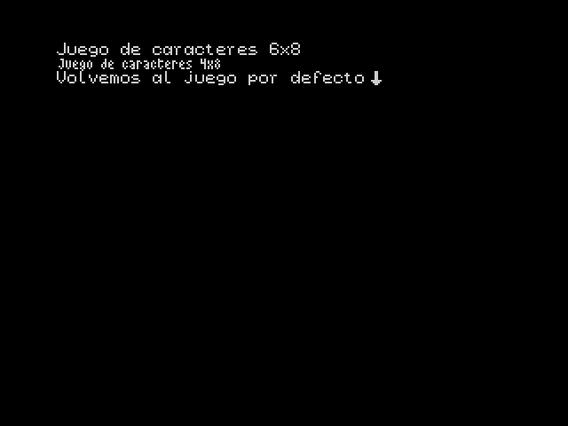

The default character set (`CHARSET 0`) consists of characters 0 to 127, which are 6 pixels wide. With `CHARSET 1`, we select characters 128 to 255, which are 4 pixels wide.

---

## Windows

Windows are up to 8 different independent text areas that we can define on the screen. In each one we can define the margins differently, and each one has its own cursor position and attributes. At any given time, we can only have one "active" window, that is, one window to write on and configure. You switch between them using the `WINDOW` command. The default active window is window zero.

As always, an example is more eloquent:

```cyd
[[/* The default window is zero */
  MARGINS 0, 0, 16, 12
  INK 2
  CLEAR
  WINDOW 1
  MARGINS 16, 0, 16, 12
  INK 6
  CLEAR
  WINDOW 2
  MARGINS 0, 12, 16, 12
  INK 4
  CLEAR
  WINDOW 3
  MARGINS 16, 12, 16, 12
  INK 5
  CLEAR
  WINDOW 0
]]This is window 0
[[
  WINDOW 1
]]This is window 1
[[
  WINDOW 2
]]This is window 2
[[
  WINDOW 3
]]This is window 3
[[
  WINDOW 0
]]Back to window 0
[[
  WINDOW 1
]]Back to window 1
[[
  WINDOW 2
]]Back to window 2
[[
  WINDOW 3
]]Back to window 3
[[
  WAITKEY
  END]]
```

In the example, 4 windows are used, from 0 to 3. First we start with window zero, which is selected by default, and we define its position, size and ink color. Then we switch to window 1 and do the same, and so on with the rest. Finally we switch between windows to put text in each one.

And this is the result:

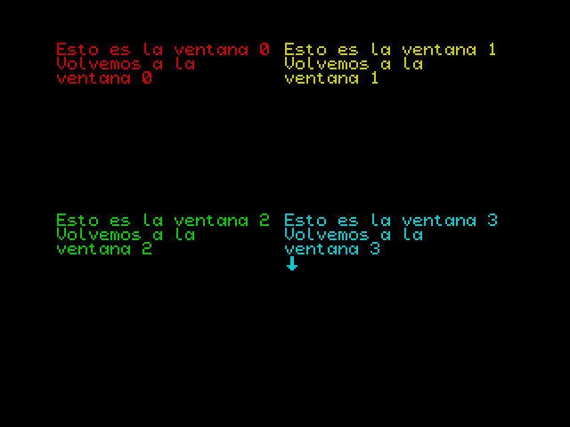

As you can see, the color, margins, and cursor position are preserved in each window, and we can easily switch between them. This allows us to have different text areas for menus, descriptions, scoreboards, etc.

Finally, it should be noted that these windows are not equivalent to the windows of a desktop environment, such as Windows, Mac, KDE, or GNOME. If two windows overlap, and you type in one of them, the content of the other window is not preserved. Think of them as text areas instead.

---

## Arrays or sequences

Arrays are sequences of numbers that can be accessed by an index. Using the `DIM` command we can declare an "array", so that with `DIM name(size)` we declare an array with the name `name` and size `size`. The size of an array cannot be greater than 256 or be zero. We access each of the elements of the array with the notation `name(pos)`, where `pos` is the position number of the element to be accessed within the array, starting from zero.

Let's see an example:

```cyd
[[
  DIM miArray(3)          /* Declare an array of 3 elements from 0 to 2              */
  LET miArray(0) = 10     /* Assign values to each element                          */
  LET miArray(1) = 11
  LET miArray(2) = 12
  PRINT miArray(0)        /* Print the value stored at position 0            */
  NEWLINE
  PRINT miArray(1)        /* Print the value stored at position 1            */
  NEWLINE
  PRINT miArray(2)        /* Print the value stored at position 2            */
  NEWLINE : WAITKEY]]
```


As you can see, we are treating `miArray(0)`, for example, as if it were a variable. It can be assigned and its values read.

But **be careful!**, arrays start counting from zero to the size we have defined in the array declaration minus one. If we try to access a position outside its range, we will get a type 7 error:

```cyd
[[
  DIM miArray(3)          /* Declare an array of 3 elements from 0 to 2              */
  LET miArray(0) = 10     /* Assign values to each element                          */
  LET miArray(1) = 11
  LET miArray(2) = 12
  PRINT miArray(0)        /* Print the value stored at position 0            */
  NEWLINE
  PRINT miArray(1)        /* Print the value stored at position 1            */
  NEWLINE
  PRINT miArray(2)        /* Print the value stored at position 2            */
  NEWLINE
  PRINT miArray(3)        /* THIS GIVES AN ERROR!                                            */
  NEWLINE : WAITKEY]]
```

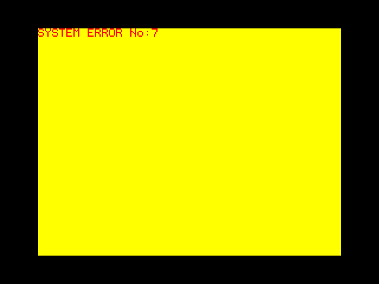

To avoid these situations, you have the `LASTPOS(array_name)` function that returns the last allowed position for the given array so you can check before assigning:

```cyd
[[
  DIM miArray(3)          /* Declare an array of 3 elements from 0 to 2              */
  LET miArray(0) = 10     /* Assign values to each element                          */
  LET miArray(1) = 11
  LET miArray(2) = 12
  PRINT miArray(0)        /* Print the value stored at position 0            */
  NEWLINE
  PRINT miArray(1)        /* Print the value stored at position 1            */
  NEWLINE
  PRINT miArray(2)        /* Print the value stored at position 2            */
  NEWLINE
  ]]Last position:[[
  PRINT LASTPOS(miArray)  /* See the last allowed position     */
  ]]
  Array size:[[
  PRINT LASTPOS(miArray)+1  /* Adding one, we get its total size */
  NEWLINE : WAITKEY]]
```

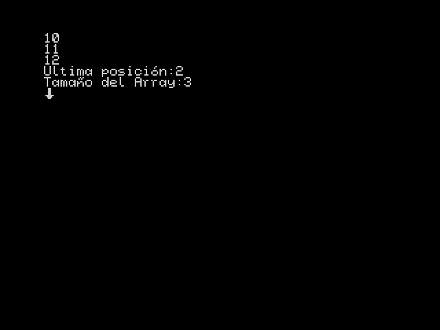

Arrays allow us to have tables of values, but initializing elements one by one can be cumbersome and inelegant.

We can initialize array values by declaring them in the following way:

```cyd
[[ DIM precios(5) = {10, 40, 100, 200, 250} ]]
```

In fact, we can skip indicating the size since it will be calculated from the number of elements indicated:

```cyd
[[ DIM precios() = {10, 40, 100, 200, 250} ]]
```

Note that in this case the array will have the size of the number of elements that we have indicated **and no more**.

Arrays cannot be resized and only accept values between 0 and 255, in the same way as variables. The maximum size is 256 and the minimum is 1.

Let's look at one last example to consolidate concepts:

```cyd
[[
  DECLARE 0 AS c
  DIM precios(5) = {10, 40, 100, 200, 250}
]] The [[ PRINT LASTPOS(precios)+1 ]] prices are:
[[
  LET c = 0
  WHILE(@c <= LASTPOS(precios))
      PRINT precios(@c)
      NEWLINE
      LET c = @c + 1
  WEND
  WAITKEY
]]
```

In the example, we use the variable `c` to iterate through the prices array until its last position and print the contents of each one:


Finally, it should be noted that another limitation that arrays have is that they cannot be recorded directly onto tape or disk, unless their contents are dumped into variables beforehand.

---

## Immutable data (DATA)

The `DIM` arrays we just saw are writable, but often what we need is a **read-only** block of data: tables, maps, sequences of values… For that, **CYD** provides the `DATA` mechanism, just like classic BASIC.

With `DATA` we append values (bytes) to a **single global stream** of data, in the order they appear in the script. We then read them one by one with `READ`, which advances an internal cursor:

```
[[
  DECLARE 0 AS v

  DATA 10, 20, 30      /* these five values form a single stream */
  DATA 40, 50          /* 10, 20, 30, 40, 50                     */

  READ v               /* v is 10, and the cursor advances to 20 */
  READ v               /* v is 20 ...                            */
]]
```

Unlike arrays, a `DATA` stream can be much bigger (up to 16 KB, thousands of values) and, on Dandanator/MLD cartridges, it **uses no RAM** because it is read straight from flash.

With `RESTORE` we rewind the cursor to the beginning, and with `RESTORE label` we place it at the first `DATA` appearing after that label (just like BASIC's `RESTORE line`):

```
[[
  DECLARE 0 AS v

  DATA 11, 22, 33
  LABEL second
  DATA 44, 55

  RESTORE second       /* the cursor jumps to 44 */
  READ v               /* v is 44                */
]]
```

To walk the whole stream without running off the end we use the `DATAEND()` function, which returns `1` when the cursor has reached the end and `0` while data remains. Note that it takes parentheses (it is a function) and that, to use it as a condition, we compare it:

```
[[
  DECLARE 0 AS v

  DATA 65, 66, 67   /* codes for 'A', 'B', 'C' */

  WHILE (DATAEND() = 0)
    READ v
    CHAR @v         /* prints A, B, C */
  WEND
]]
```

A handy detail: if we keep reading with `READ` past the end, the stream **rewinds by itself** to the beginning (an "endless tape"), so we never read garbage. Use `DATAEND()` when you want to stop at the end.

---

## Wide constants (WORD, DWORD and strings)

So far every value we put into variables, arrays or `DATA` was one byte (0 to 255). But sometimes we need bigger numbers: a score reaching the thousands, a memory address, or simply the text of a string. That is what **wide constants** are for; the compiler turns them into several consecutive bytes (in *little-endian* order: low byte first). Everything is resolved at compile time, so they **cost nothing** in speed or extra memory.

In `DATA` and in a `DIM` initializer the width is detected automatically from the size of the number (up to 255 = 1 byte, up to 65535 = 2 bytes, larger = 4 bytes). And if we want to force a specific width, we put `WORD` (2 bytes) or `DWORD` (4 bytes) in front. A quoted string is stored as its character codes:

```cyd
[[
  DATA WORD 1000, 5, "HI"          /* 1000 (2 bytes) + 5 (1 byte) + 'H','I' */
  DIM table() = { DWORD 100000, 42 }   /* a 5-byte array */
]]
```

Arrays are still "byte by byte": if you store a `WORD` it takes two positions of the array and you have to reassemble the number by reading those two bytes (with the `math16_32` library if you are going to operate on it).

We can also assign a wide constant directly to a variable with `LET`/`SET`; the bytes are stored in the given variable and the following ones:

```cyd
[[
  DECLARE 0 AS score     /* uses variables 0 and 1 */
  DECLARE 2 AS name      /* uses variables 2 and 3 */
  LET score = WORD 1000  /* var 0 = low byte, var 1 = high byte */
  LET name = "AB"        /* var 2 = 'A', var 3 = 'B'            */
]]
```

Note: in `LET`/`SET` you **must** write `WORD`/`DWORD` (or the string) for it to be wide; without the marker, `LET score = 1000` would still try to store a single byte and would give an error because it doesn't fit. This way you always know how many variables you will use.

---

## More conveniences: SELECT, ENUM, SWAP and literals

**CYD** also has a few helpers that make the code more readable. They all compile down to things you already know (they add nothing to the engine).

### SELECT ... CASE (multi-branch)

When you have to choose between several values of a variable, instead of chaining many `IF`s, use `SELECT`:

```cyd
[[
   SELECT @state
     CASE 0        GOSUB intro
     CASE 1, 2, 3  GOSUB game      /* several values, same branch */
     CASE ELSE     GOSUB theEnd    /* default (optional)          */
   ENDSELECT
]]
```

`@state` is evaluated and the matching `CASE` branch runs. There is no "fall-through" from one branch to the next: when a branch ends, it jumps to the end. `CASE ELSE` is optional.

### ENUM (named constants)

To avoid magic numbers, `ENUM` declares a list of constants numbered automatically from 0:

```cyd
[[
   ENUM { NORTH, SOUTH, EAST, WEST }   /* NORTH=0, SOUTH=1, EAST=2, WEST=3 */
   ENUM Item { SWORD=1, SHIELD, POTION=10, KEY }  /* 1, 2, 10, 11 */
]]
```

You can set a value with `=` and the following ones continue from there. The names become ordinary global constants (the name after `ENUM` is only decorative).

### SWAP (exchange two variables)

Exchanges the contents of two variables without needing a third one:

```cyd
[[ SWAP a, b ]]
```

It also works with indirection on either side: `SWAP [p], [q]`.

### Handy literals

In `DATA` and `DIM` lists (and anywhere a number goes) you have:

- **Character `'A'`**: the character's code, without memorizing it. `LET key = 'A'` is the same as `LET key = 65`.
- **Ranges `{a..b}`**: `DIM count() = { 1..8 }` makes 1,2,3,4,5,6,7,8 (and reversed if `a > b`).
- **Repetition `{ v REPEAT n }`**: `DIM buffer() = { 0 REPEAT 16 }` makes sixteen zeros.

And they combine: `DATA 255 REPEAT 4, 1..3, 'A'`.

---

## Changing the character set

**CYD** has the following default character set:


The characters are arranged in the image as a grid, starting from the top left, and going from left to right and from top to bottom.

You can see both the 6x8 characters of the normal mode and the 4x8 characters of the alternative mode, as well as the characters used in the animated wait and selection icon:


Characters 127 through 143 (both inclusive and starting from zero) are special and have the following functions:

- Character 127 is the character used when an option is not selected in a menu. (In red in the screenshot above)
- Characters 128 through 135 form the animation cycle of a selected option in a menu. (Green in the screenshot above)
- Characters 136 to 143 form the key wait indicator animation cycle. (Blue in the screenshot above)

Once we have this clear, what many of you will want is to change the animated icons to give them a personal touch.
For this task we will need **ZxPaintbrush**, a separate tool that is not bundled with CYD. We will also need the default font found in the `assets\default_charset.chr` file.

We will copy the file to the folder of our project, rename it to `charset.chr` and open it with ZxPaintbrush and with this we will have this:


We are going to edit the key wait animation cycle (those marked in blue in the second screenshot). I'm going to put a clock, please excuse my poor artistic skills:


Now we need to convert them to a format that the compiler can digest. To do this we use the cyd_chr_conv tool, which is located in the `dist` folder of CYD (`dist\cyd_chr_conv.cmd`). This is a command-line tool, so we will have to open a *Command Prompt* window in the project's folder. If CYD is in the `CYD` folder next to it, as at the beginning of this tutorial, and we run this command `..\CYD\dist\cyd_chr_conv.cmd --help`, we can see the options.


To do the conversion, we'll use it like this:

```batch
..\CYD\dist\cyd_chr_conv.cmd -w 6 -W 4 charset.chr charset.json
```

With the parameter `-w`, we indicate the width that the characters of the lower set will have, which in our case is 6 and with `-W` we indicate the size of the characters of the upper set, 4 in this case.

With this, we already have the file `charset.json` that we would have to pass to the compiler.


To tell the compiler that we are going to use the new character set, we would normally indicate it with the parameter `-c`. Fortunately, here we don't have to do anything: when the project is built, if there is a file called `charset.json` in its folder, it is used automatically. If you prefer to give it another name or keep it somewhere else, put its path in the `charset` setting of the `[paths]` section of `cyd_project.ini`:

```ini
[paths]
charset = fonts/my_charset.json
```

Building the project again and launching the resulting tape file with an emulator, we see that the icon has changed:


In this way, we can change the rest of the animated icons, the fonts in general or even make special graphic characters, like "UDG", and display them with the `CHAR` command.

---

## Native routines (IMPORT / CALL)

For jobs the virtual machine cannot do on its own — reading or writing a hardware port, touching an arbitrary memory address, or a tight bit of number-crunching that has to be fast — you can write a small routine in **Z80 assembly** and call it from your script.

> **Advanced, use at your own risk.** This runs your own native code with no safety net: a bug in the routine can hang or crash the machine, just like the BeepFx or WyzTracker code you already trust. If you are not comfortable with Z80 assembly, you do not need this feature.

Two keywords are involved:

```
[[
    IMPORT peek FROM "peek.asm"   /* declare the routine (compile-time) */
    SET 0 TO 0 : SET 1 TO 0       /* address 0000h in variables 0 and 1 */
    CALL peek                     /* run it; it leaves the result in variable 2 */
]]
```

- `IMPORT name FROM "file.asm"` registers a native routine. It is a compile-time declaration (like `DECLARE`), **not** an `INCLUDE`. A relative path is resolved relative to the **folder of your `.cyd` script**.
- `CALL name` runs it, the same way `GOSUB` calls a subroutine written in CYD.

You write **only the body** of the routine (no `ORG`, no directives); the compiler frames it, assembles it in isolation and places it in memory for you. The routine is entered with **`DE = FLAGS`**, the base of the variable array, so inputs and outputs travel through variables (variable `n` is the byte at `FLAGS + n`) and it must end with `RET`. For example, this `peek.asm` reads the byte at the address formed by variables 0 and 1 and leaves it in variable 2:

```asm
    ld a, (de)      ; DE = FLAGS -> A = variable 0 (address low byte)
    ld l, a
    inc de
    ld a, (de)      ; A = variable 1 (address high byte)
    ld h, a         ; HL = the address to read
    inc de          ; DE -> variable 2
    ld a, (hl)      ; A = the byte at that address
    ld (de), a      ; variable 2 = result
    ret
```

It works on all targets (48K, 128K, +3, esxdos, mld and mld128). There is a full, runnable example in `examples/import_demo`, and the detailed contract (ABI) reference in the manual, section **Native routines (IMPORT / CALL)**.

### Writing the assembly inline (`ASM … ENDASM`)

You don't always want a separate file. You can write the body **directly in the `.cyd`** between `ASM name` and `ENDASM`, and call it with `CALL` just as before:

```
[[
    ASM put42
        ld a, 42
        ld (de), a          ; DE = FLAGS -> variable 0 = 42
        ret
    ENDASM
    CALL put42
]]
```

It is the same ABI as with `IMPORT` (entered with `DE = FLAGS`, ends in `RET`): `ASM … ENDASM` is just an `IMPORT` with the body inline. You may indent the block to line it up with the `[[ ]]`; the compiler places the labels where the assembler needs them.

From there, a block can expose **several routines** that share code (`ASM lib EXPORTS a, b`), your routines can **read the script's arrays** by name (`ARR_<name>`, with services that do the paging for you on 128K/+3), and one routine can **call another in a different block** with `CYD_CALL` by declaring it in `USES`. Also, a routine nobody calls takes no memory: it is dropped automatically.

All of this is explained in detail in the manual (section **Native routines**), and there is a complete example that brings it together in `examples/inline_asm`. The idea is to be able to write comfortable native "libraries" when the virtual machine falls short on speed.

